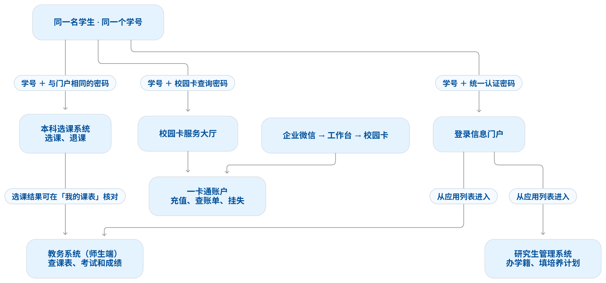

下面以学生为例。**本科选课和信息门户用同一套账号密码；校园一卡通也认学号，但网页查卡用的是校园卡自己的查询密码。**

容易混淆的是这两点：

- **能登录门户，仍可能不能选课。** 门户登录验证身份，选课系统还会检查学籍、注册状态和当前选课轮次。 [本科生院选课通知](https://www.scuec.edu.cn/jwc/info/1003/4133.htm)
- **忘了密码，要看是哪个入口。** 忘了门户或本科选课密码，走统一身份认证的找回流程；忘了校园卡查询密码，走校园卡的密码处理流程。 [统一身份认证使用指南](https://www.scuec.edu.cn/metc/info/1033/1466.htm) · [校园卡常见问题](https://www.scuec.edu.cn/metc/info/1033/1277.htm)