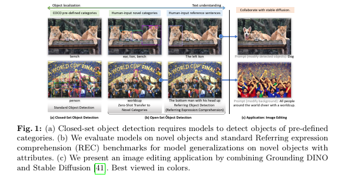
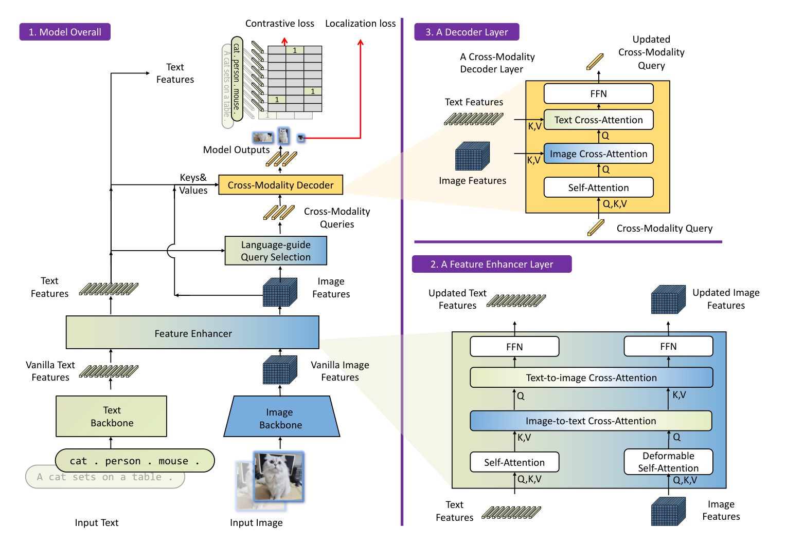
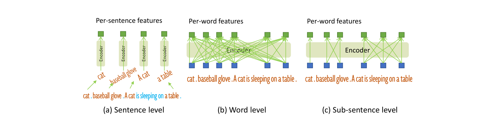

# Grounding DINO 论文汇报

> 开放词汇目标检测中的三阶段视觉语言融合

Grounding DINO: Marrying DINO with Grounded Pre-Training for Open-Set Object Detection

Shilong Liu 等  |  arXiv 2303.05499v5  |  版本日期 2024年7月19日

## 核心结论

Grounding DINO把DINO检测器与区域—文本定位预训练结合，让语言参与特征增强、候选查询选择和解码细化。它提供了可由文本指定目标的检测能力，但长尾类别和细粒度指代理解仍受训练覆盖与监督目标限制。

*图1  闭集检测 开放词汇检测与图像编辑应用  来源 原文图1 第1页*

## 研究问题

传统检测器使用固定类别集合。本文研究如何让用户通过类别名称或自然语言描述改变检测目标，并让文字真正影响模型关注的位置和框的细化过程。

## 本次汇报的主线

任务与背景 → 三阶段融合方法 → 训练与数据 → 关键实验 → 局限与研究启示。

## 1  任务定义与研究背景

### 从固定类别到文字指定目标

| 任务 | 文本输入示例 | 需要完成的判断 |
| --- | --- | --- |
| 闭集目标检测 | 类别集合预先固定 | 检测训练时规定的对象类别 |
| 开放词汇检测 | dog . cat . | 定位这些类别的多个实例 |
| 指代表达理解 REC | the dog on the left | 在同类对象中选出满足描述的实例 |

类别名称提供语义条件，指代表达还要求属性与关系理解。例如“狗”与“左边的狗”需要不同层次的判断，因此类别检测性能不能替代指代定位性能。

### 两条技术路线在本文中结合

DINO是基于DETR的强目标检测器，利用对象查询预测一组框，但原有分类头面向固定类别。这里的DINO指检测模型，不是同名视觉自监督模型。

GLIP将目标检测转化为短语定位，通过区域与文本之间的对齐学习获得语言条件检测能力。Grounding DINO继承这一预训练思路，并针对Transformer检测流程设计更紧密的融合。

### 零样本结果应如何理解

本文将零样本定义为训练时未使用被测试数据集的训练划分，不要求测试类别的语义概念从未在其他预训练数据中出现。Objects365几乎覆盖COCO类别，所以52.5 AP不能直接解释为对完全未知概念的检测能力。

### 评测指标

检测AP综合预测排序下的精确率与召回率；COCO式主AP还对多个IoU阈值平均。IoU是预测框与真实框交集面积除以并集面积。52.5 AP不等于52.5%的图像检测正确。REC报告首选框定位准确率，与检测AP不可直接比较。

来源  原文第2至5页 第9页  第2页脚注

## 2  模型框架与三个融合位置

*图2  整体框架与特征增强层 跨模态解码层  来源 原文图3 第5页*

### 特征增强

Swin提取多尺度图像特征，BERT提取文本词元特征。增强层包含图像可变形自注意力、文本自注意力和双向图文交叉注意力，形成与当前文本有关的视觉与语言表示。

### 语言引导查询选择

以视觉位置与文本词元的匹配分数选择900个候选位置，初始化解码器的位置部分。候选预算由当前文本引导，不是每个类别固定分配相同数量的框。

### 跨模态解码

每层依次执行查询自注意力、图像交叉注意力、文本交叉注意力和前馈网络。6层解码持续更新对象表示并细化框；最终输出框和对应短语。语言因此贯穿特征、候选和细化三个阶段。

## 3  查询选择与文本表示

### 查询选择的计算过程

$$
S = X_I X_T^{\mathsf T},\qquad s_i = \max_j S_{ij},\qquad I = \operatorname{TopKIndices}(s,900)
$$

图像特征有$N_I$个位置，文本特征有$N_T$个词元，公共维度d为256。点积得到$N_I$ × $N_T$的匹配矩阵；先沿文本维取最大值，使每个位置保留最相关词元的分数，再沿视觉位置取前900个索引。

混合查询初始化沿用DINO：位置部分由编码器输出的动态锚框初始化，内容部分仍是可学习查询。900是候选数，不是固定输出900个有效目标。

**公式的含义是“与任一词元相关的位置值得关注”。它本身没有显式要求同时满足颜色、位置和关系等全部条件，复杂指代能力仍需实验检验。**

### 子句级文本表示

*图3  句子级 词级与子句级表示  来源 原文图4 第6页*

句子级表示压缩细粒度词信息；普通词级表示使任意拼接的无关类别相互影响。子句级表示用注意力掩码隔离独立类别片段，同时保留片段内部的词元关系。

例如“cat . baseball glove .”中，baseball与glove应保持联系，两个独立类别之间则无需因拼接顺序而产生语境依赖。屏蔽的是不必要的文本内部交互，图文融合仍然保留。

来源  原文公式1 第7页  第6至8页  附录算法1 第20页

## 4  预训练数据与优化目标

### 用区域与文本对齐统一训练接口

| 数据类型 | 使用方式 | 主要数据 |
| --- | --- | --- |
| 检测数据 | 将类别名称拼成文本 建立框与词元对应 | Objects365 OpenImages 部分配方加入COCO |
| 定位数据 | 直接学习短语与图像区域的对应 | GoldG与RefC |
| 图像描述数据 | 使用GLIP生成的伪框形成定位监督 | Cap4M |

GoldG包括Flickr30k Entities与Visual Genome的定位数据；RefC指RefCOCO、RefCOCO+、RefCOCOg。Cap4M的伪标签继承教师的类别覆盖与误差。不同实验行使用的数据配方并不相同。

### 先匹配 再计算分类与定位损失

$$
\mathcal L = \mathcal L_{\mathrm{cls}} + 5\mathcal L_{\mathrm{L1}} + 2\mathcal L_{\mathrm{GIoU}}
$$

上式概括正文第9页的最终损失权重。匈牙利匹配先建立预测与真实框的对应，再计算损失。分类通过查询与文本词元的点积产生得分并使用焦点损失；定位结合框坐标L1损失与广义交并比损失。编码器和各解码层另有辅助监督。

### 实验资源与配置

| 项目 | T模型 | L模型 |
| --- | --- | --- |
| 图像骨干 | Swin-T | Swin-L |
| Objects365版本 | v1 约60万图像 | v2 约170万图像 |
| 训练资源 | 16张V100 批大小32 | 64张A100 批大小64 |
| 共同设置 | BERT-base 隐藏维度256 | 增强器6层 解码器6层 |

优化器为AdamW，主学习率10⁻⁴，图像与文本骨干学习率10⁻⁵。T与L的对比同时改变骨干、数据和资源，不能将最终差距仅归因于模型规模。

参数核对  正文匹配的分类系数为2 最终分类损失系数为1 附录表8则分别为1与2 实际复现应核对所选版本配置

## 5  COCO结果与模块消融

### 受控比较支持方法价值

| 模型与预训练数据                        | 直接迁移AP | 微调后AP |
| ------------------------------- | ------ | ----- |
| DINO-T  O365                    | 46.2   | 56.9  |
| GLIP-T B  O365                  | 44.9   | 53.8  |
| Grounding DINO T  O365          | 46.7   | 56.9  |
| GLIP-T C  O365加GoldG            | 46.7   | 55.1  |
| Grounding DINO T  O365加GoldG    | 48.1   | 57.1  |
| Grounding DINO T  再加Cap4M       | 48.4   | 57.2  |
| Grounding DINO L  O365加OI加GoldG | 52.5   | 62.6  |

同为O365与Swin-T，Grounding DINO相对DINO提高0.5 AP，相对GLIP提高1.8 AP。T加入GoldG后由46.7升至48.1 AP，说明区域—文本训练带来额外收益。52.5 AP则体现更强骨干和更大数据下的系统能力。

来源  原文表2 第8页  微调列统一取COCO验证集结果

### 逐项消融验证三个融合位置

| 变体        | COCO迁移AP | LVIS迁移AP |
| --------- | -------- | -------- |
| 完整模型      | 46.7     | 16.1     |
| 移除编码器图文融合 | 45.8     | 13.1     |
| 改用静态查询选择  | 46.3     | 13.6     |
| 移除文本交叉注意力 | 46.1     | 14.3     |
| 改用普通词级提示  | 46.4     | 15.6     |

所有行均用O365与Swin-T。各模块被移除后性能下降，支持其在完整系统中的作用。差值不能相加成独立贡献；也不能由此证明模型已掌握关系推理。

来源  原文表7 第14页  查询选择在LVIS上的差值为16.1−13.6＝2.5 AP 正文写作3.0 AP与表格不符

## 6  长尾与跨域泛化

### LVIS总分优势未覆盖稀有类别

| 模型与训练配方 | 总AP | 稀有类APr |
| --- | --- | --- |
| GLIP-T C  O365加GoldG | 24.9 | 17.7 |
| Grounding DINO T  同配方 | 25.6 | 14.4 |
| GLIP-T  再加Cap4M | 26.0 | 20.8 |
| Grounding DINO T  再加Cap4M | 27.4 | 18.1 |
| DetCLIPv2-T  O365加GoldG加CC15M | 40.4 | 36.0 |

两组与GLIP的比较中，总AP更高而稀有类AP更低。开放词汇接口并没有自动补齐长尾视觉知识。DetCLIPv2的额外数据不同，无法只用最终分数比较架构优劣。

来源  原文表3 第10页  均为直接迁移设置

### ODinW应同时看平均与中位数

| 模型与训练配方 | 平均AP | 中位AP |
| --- | --- | --- |
| GLIP-T  O365加GoldG加Cap4M | 19.6 | 5.1 |
| GLIPv2-T  同数据名称配方 | 22.3 | 8.9 |
| Grounding DINO T  O365加GoldG | 20.0 | 9.5 |
| Grounding DINO T  再加Cap4M | 22.3 | 11.9 |
| Grounding DINO L  完整混合配方 | 26.1 | 18.4 |

T与GLIPv2-T均值相同，中位数更高，说明排序居中的数据集表现更好；两个统计量不足以严格证明方差更小。L配方为O365、OI、GoldG、Cap4M、COCO和RefC，不能与COCO零样本52.5 AP所在配方视作同一行。

**PlantDoc反例  在O365加GoldG加Cap4M条件下 Grounding DINO T仅0.36 AP GLIP-T为1.10 AP 汇总改善不能保证专业病害类别可用**

来源  原文表4 第11页  表18 第33页  ODinW35零样本设置

## 7  指代定位与训练数据的取舍

### REC需要属性与关系层面的判断

| 模型与训练情况 | 任务微调 | RefCOCO val |
| --- | --- | --- |
| GLIP-T  O365加GoldG | 无 | 49.96 |
| Grounding DINO T  O365加GoldG | 无 | 50.41 |
| Grounding DINO T  再加RefC | 无 | 73.98 |
| Grounding DINO T  再加RefC | 有 | 89.19 |

没有REC数据时提升很小，加入RefC并进行任务微调后才显著提高。后两行即使预训练数据名称相同，也因微调标记不同而属于不同协议。

作者提出，REC通常要求一个表达对应唯一框，而一般定位预训练可能奖励找出多个对象，监督目标不一致会影响迁移。这是对现象的解释，尚未被独立证明是唯一原因。最佳L行还注明COCO与RefC可能存在图像重叠。

来源  原文表5 第12页  附录D3 第25至26页  指标为Top-1定位准确率

### 加入数据可能提高一个任务 降低另一个任务

| Grounding DINO T训练数据 | COCO AP | LVIS AP | ODinW AP |
| --- | --- | --- | --- |
| O365加GoldG | 48.1 | 25.6 | 20.0 |
| 再加RefC | 48.5 | 21.9 | 17.7 |
| 再加COCO | 56.1* | 22.3 | 17.4 |

*最后一行COCO已参与训练，56.1不是严格COCO零样本结果。来源为原文表6，第13页。

RefC带来COCO小幅增长，却使LVIS与ODinW下降。该结果提示数据分布、监督目标和采样配方存在能力取舍，不能把数据总量增加理解为所有任务都会改善。

### 对方法设计的启示

应分别诊断类别覆盖、框定位、同类实例选择和关系理解。若主要问题是关系选错，增加普通类别数据未必能解决；若连类别都识别不出，则应先检查训练覆盖与领域差异。

## 8  论文评价与后续研究

### 主要贡献

第一，语言贯穿特征、候选和解码三个接口，尤其让目标文本参与有限查询的分配。第二，将DINO检测基座与区域—文本定位预训练系统结合，并用子句掩码减少无关类别干扰。第三，通过跨域和指代任务揭示开放词汇能力的具体边界。

### 现有证据的限制

架构归因  L的最终成绩同时改变骨干、数据和资源；消融支持局部设计作用，但没有全面分离这些因素。

可靠性  作者承认存在误检，尚未建立不存在目标时的可靠拒识保证。检测框会把错误传递给后续标注或图像编辑模块。

统计与任务范围  主表没有多次独立运行区间，小幅AP提升仍需重复验证。模型本身输出框与短语，不直接产生分割掩码或生成图片。

### 后续先做小规模诊断

| 优先级 | 验证问题 | 对照与交付结果 |
| --- | --- | --- |
| 1 | 提示是否稳定 | 固定检查点和阈值 对比同义词 顺序及无关类别 形成可追溯失败案例表 |
| 2 | 关系理解错在哪里 | 同图对比类别 属性和关系表达 人工确认唯一真值 统计Top-1定位与错误类别 |
| 3 | 负提示是否误报 | 加入图中不存在的类别 扫阈值 在固定真实目标召回下比较误报 形成曲线 |

以上为拟开展的研究计划。先根据诊断结果决定补数据、改候选机制还是引入关系监督；正式样本量、阈值和资源预算应在试验后估计，不预设改进幅度。

### 结论

**Grounding DINO的重要价值是让语言成为检测过程中的持续条件。它在给定协议中有效，但类别命名、视觉知识覆盖和关系理解仍是需要分别验证的能力。**

## 9  补充证据与讨论备查

### 增加查询数的收益有限

| 查询数 | COCO AP | LVIS AP | 稀有类APr |
| --- | --- | --- | --- |
| 900 | 46.7 | 15.8 | 9.4 |
| 1200 | 46.7 | 15.7 | 9.0 |
| 1500 | 46.9 | 15.8 | 9.2 |

来源  表15 第31页  原笔记1200查询的9.7已在本报告纠正为9.0 附录文字宣称稀有类提升但表中不支持 表7的LVIS基线16.1也不应与此表15.8混同

### 三项补充结果

权重迁移  冻结与DINO共有模块，只训练新增部分：O365加GoldG下，COCO/LVIS/ODinW为46.4/26.1/18.5；从头训练为48.1/25.6/20.0。可复用已有权重，但并非全面持平。（表9，第21页）

闭集反例  ResNet-50、COCO、12轮训练中，Grounding DINO为48.1 AP，DINO为49.0 AP。新增语言模块不保证所有闭集设置都提升。（表11，第22页）

效率对比  Grounding DINO T为172M参数、464G计算量、8.37 FPS；GLIP-T为232M、488G、6.11 FPS。仅适用于作者测速环境，不能作为目标设备实时性承诺。（表20，第26页）

### 讨论问题

如何区分类别未覆盖与关系理解失败？候选选择中的最大值操作会不会偏向只匹配单个词元的位置？在统一数据和算力预算下，哪些改进仍然成立？

### 论文来源

Shilong Liu, Zhaoyang Zeng, Tianhe Ren, Feng Li, Hao Zhang, Jie Yang, Qing Jiang, Chunyuan Li, Jianwei Yang, Hang Su, Jun Zhu, Lei Zhang. Grounding DINO: Marrying DINO with Grounded Pre-Training for Open-Set Object Detection. arXiv:2303.05499v5, 2024-07-19.

原文  [论文原文](https://arxiv.org/abs/2303.05499v5)  
代码  [作者代码仓库](https://github.com/IDEA-Research/GroundingDINO)
