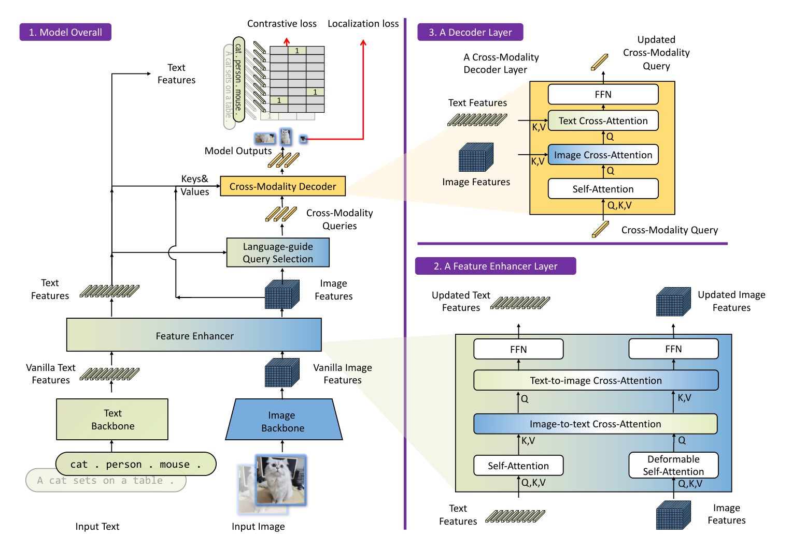
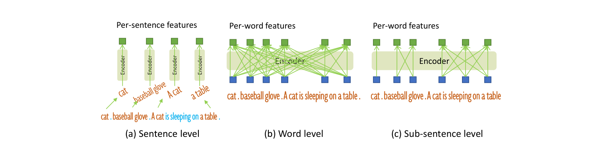
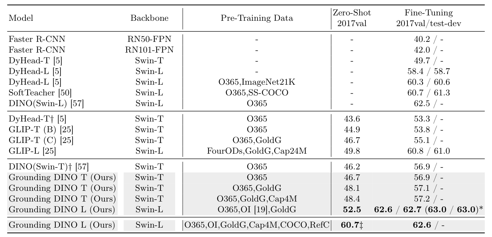
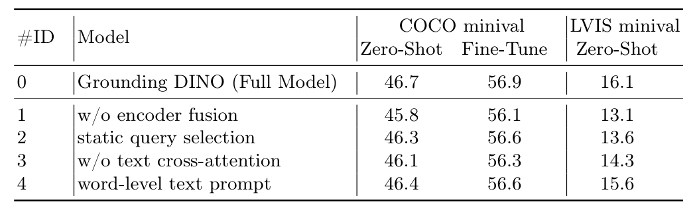

# Grounding DINO：让语言参与目标检测的全过程

**论文：**Grounding DINO: Marrying DINO with Grounded Pre-Training for Open-Set Object Detection  
**作者：**Shilong Liu 等  
**版本：**2023年首次预印本；本文依据 arXiv:2303.05499v5，2024-07-19。

**这篇论文最核心的创新，是让语言参与目标检测的三个关键阶段：特征融合、候选选择和检测框细化。** 这样，文字既能告诉模型“要找什么”，也能影响“先去哪里找”和“怎样继续定位”。

---

## 1．它要解决什么问题？

传统目标检测器通常只能识别训练时规定的类别。例如，模型的分类头只有“人、汽车、狗”，即使图片里出现其他物体，也没有相应的类别输出。

Grounding DINO希望把类别改成用户可以输入的文字：

- 输入 `cat . dog . chair .`，检测这些类别的物体。
- 输入 `the lion on the left`，尝试定位“左边的狮子”。

模型接收的是**图片＋文字**，输出的是**检测框＋对应的文字短语**。这里的Grounding，可以理解为“把语言中的概念对应到图像中的具体位置”。

这涉及两种相关但不同的能力：

| 任务 | 输入例子 | 模型需要判断什么？ |
| --- | --- | --- |
| 开放词汇目标检测 | `dog` | 图片里哪些物体是狗？ |
| 指代表达理解（REC） | `the dog on the left` | 多只狗中，哪一只是左边的狗？ |

**能识别类别，不代表能正确理解属性、位置和关系。** 因此，论文除了评估类别检测，也评估根据描述选择目标实例的能力。

*来源：原文引言，第2—4页。*

---

## 2．为什么要把DINO和定位预训练结合？

这篇论文建立在两条已有技术路线之上。

**DINO提供较强的目标检测能力。** 它使用Transformer和对象查询预测目标框，擅长回答“物体在哪里”，但原有分类头面向固定类别。这里的DINO指目标检测模型。

**GLIP提供区域与文字对齐的训练思路。** 它把目标检测转成短语定位，让模型学习“这个区域对应哪个词或短语”。这样，类别就可以通过文字表达。

Grounding DINO将两者结合，进一步研究：**语言应该在哪些环节影响检测？**

| 已有基础 | 主要作用 | Grounding DINO的进一步设计 |
| --- | --- | --- |
| DINO | 提供较强的框定位和目标预测能力 | 让检测过程能够持续读取语言条件 |
| GLIP的定位预训练 | 学习区域与文本的对应关系 | 在Transformer检测流程中实现三个阶段的融合 |

因此，本文的创新不能简单概括为“第一次用文字做检测”。它的主要贡献在于，**围绕DINO的检测流程，系统设计语言与视觉的交互位置和方式。**

*来源：原文引言、相关工作及第3节。*

---

## 3．整体框架：图像和文字怎样一起完成检测？

*原文Fig. 3，第5页。左边是整体流程，右下是特征增强器，右上是跨模态解码器。*

图像先通过Swin提取多尺度视觉特征，文字通过BERT提取文本词元特征，然后依次经过三个关键阶段：

**图文特征融合 → 根据文字选择候选位置 → 结合图像和文字细化检测框。**

| 阶段 | 对应模块 | 解决的问题 |
| --- | --- | --- |
| 特征融合 | 特征增强器 | 图像特征和文字特征如何对齐？ |
| 候选选择 | 语言引导的查询选择 | 有限的检测资源应该优先分配给哪里？ |
| 检测框细化 | 跨模态解码器 | 候选不断更新时，怎样继续参考目标描述？ |

最终，模型预测边界框，并将对象表示与文本词元匹配，得到对应的文字标签。检测任务保留多个目标；指代定位任务取分数最高的候选框。

---

## 4．三阶段融合具体是怎么工作的？

假设图片里有猫、狗和桌子，输入文字为 `cat`，模型依次完成下面三件事。

### 第一步：让图像和文字互相交流——特征增强器

图像特征和文字特征由不同网络提取，两者不会天然对应。特征增强器通过双向交叉注意力，让图像区域读取文字信息，也让文字特征结合当前图像中的信息。

直观来说，就是让视觉表示结合“现在要找猫”这个条件，同时让文字表示结合“这张图片里有哪些相关视觉证据”。

增强器内部还包含图像侧的可变形自注意力和文本侧的自注意力，分别处理各自模态的信息。

**这一阶段的作用：先让图像区域与文字建立联系，为后续候选选择和定位提供更合适的特征。**

### 第二步：根据文字选择值得重点检查的位置——语言引导的查询选择

检测器中的Query，可以先理解为一个“负责寻找目标的候选槽位”。图像包含大量特征位置，解码器只处理有限数量的候选。

Grounding DINO计算每个图像位置与各个文本词元的相似度，取该位置最高的匹配分数，再选择分数最高的**900个位置**。

因此，输入 `cat` 与输入 `dog` 时，优先选择的位置可以不同。

**这一阶段的作用：让当前文字参与候选位置的分配，把检测资源优先放到相关区域。**

计算过程可以写成：

$$
S=X_I X_T^{\mathsf T},\qquad s_i=\max_j S_{ij},\qquad I=\operatorname{TopKIndices}(s,900).
$$

| 符号 | 含义 |
| --- | --- |
| <i>X</i><i>I</i> | 图像特征，每行对应一个视觉位置 |
| <i>X</i><i>T</i> | 文本特征，每行对应一个文本词元 |
| <i>S</i><i>ij</i> | 第 i 个视觉位置与第 j 个文本词元的匹配分数 |
| <i>s</i><i>i</i> | 第 i 个视觉位置与所有文本词元中的最高匹配分数 |
| <i>I</i> | 选出的900个视觉位置索引 |

这个公式先沿文本维取最大值，再沿视觉位置取前900名。一个位置只要与任意一个词元高度相关，就可能入选。

严格来说，这些位置用于初始化查询的位置部分；查询的内容部分仍是可学习的参数。**900是内部候选数，不是固定输出900个有效目标，也不是每个类别分配900个框。**

### 第三步：在细化检测框时继续参考文字——跨模态解码器

普通DINO的解码器主要根据图像更新候选。Grounding DINO在每层额外加入文本交叉注意力，让候选在逐层更新时持续读取语言条件。

每个解码层依次执行：

**查询自注意力 → 图像交叉注意力 → 文本交叉注意力 → 前馈网络。**

其中，图像交叉注意力读取视觉证据，文本交叉注意力读取目标条件。经过6层解码，对象表示和位置不断更新，最后得到检测框和对应短语。

**这一阶段的作用：让候选在细化过程中持续与目标描述保持关联。**

三个阶段合起来，就是论文所说的“三阶段紧密融合”：特征先对齐，候选按语言选择，解码继续读取语言。

*来源：原文第3.1—3.3节、Fig. 3、公式1及附录算法1。公式为等价分步写法。*

---

## 5．另一个重要改进：子句级文本表示

*原文Fig. 4，第6页。从左到右分别为句子级、词级和子句级表示。*

如果一次检测多个类别，可以输入：

`cat . baseball glove . chair .`

这些类别只是排列在一起，“猫”“棒球手套”和“椅子”之间没有句子语义关系。如果所有词都自由地互相注意，就可能引入不必要的依赖。

但如果把每个短语压成一个向量，又会减少细粒度的词元信息。

作者采用子句级表示，通过注意力掩码，**隔离不同类别之间的交互，同时保留一个短语内部的联系。** 这样，`baseball`和`glove`仍能共同表达“棒球手套”，独立类别之间则减少无意义的上下文干扰。

| 表示方式 | 主要特点 |
| --- | --- |
| 句子级表示 | 将句子或短语压缩为一个特征，细粒度词元信息受限 |
| 普通词级表示 | 保留词元，但独立类别之间可能产生不必要的依赖 |
| 子句级表示 | 保留词元，同时隔离独立片段之间的文本注意力 |

这里限制的是文本内部不必要的交互，图像与文字之间的融合仍然保留。

*来源：原文第3.4节、第6—8页。*

---

## 6．它的创新点具体在哪里？

可以从主要架构、关键设计、文本表示和训练整合四个方面理解。

| 层次 | 具体贡献 | 价值 |
| --- | --- | --- |
| **主要创新** | 在特征增强、查询选择、解码器三个阶段系统地融合语言 | 让语言影响完整检测过程 |
| **关键设计** | 用图文相关性选择查询的初始位置 | 候选选择随输入文字变化 |
| **文本表示改进** | 子句级文本表示 | 减少独立类别名称之间的无意义干扰 |
| **训练路线整合** | 在DINO上结合区域与文本对齐的定位预训练 | 利用检测、短语定位和伪标注数据训练开放类别检测器 |

其中，语言引导的查询选择属于三阶段融合中的关键组成，并不是与整体架构完全独立的另一套方法。

需要明确的是，**把目标检测转成短语定位、利用区域与语言对齐进行预训练，这条思路此前GLIP已经提出。** Grounding DINO的贡献在于把这条路线与DINO结合，并系统设计三阶段融合及文本表示，不能把整套定位预训练思想都归为它的原创。

此外，论文将指代定位纳入评估，揭示了类别检测与细粒度语言理解之间的差距。这扩展了评估范围，也帮助判断模型能力的边界。

---

## 7．模型怎样从不同类型的数据中学习？

不同数据集的标注形式不同，但可以统一成一个问题：**这个图像区域，对应哪个词或短语？**

例如，检测数据中的一个“猫”框，可以与输入文本中的 `cat` 对应；定位数据中“一只睡在桌子上的猫”，可以直接与相应区域对应。

| 数据类型 | 使用方式 | 主要数据 |
| --- | --- | --- |
| 目标检测数据 | 类别名称转为文本，建立框与词元的对应 | Objects365、OpenImages；部分配方加入COCO |
| 短语定位数据 | 直接学习短语与区域的对应 | GoldG：Flickr30k Entities、Visual Genome |
| 指代定位数据 | 学习描述与目标实例的对应 | RefC：RefCOCO、RefCOCO+、RefCOCOg |
| 图像描述数据 | 用GLIP生成伪框，形成区域监督 | Cap4M |

训练时，先用匈牙利匹配确定预测框与真实框的对应，再监督两件事：

- **目标与文字是否匹配：**查询与文本词元点积产生分类分数，使用焦点损失。
- **目标框是否准确：**通过边界框L1损失和GIoU损失约束位置，并对中间层施加辅助监督。

图像描述本身没有目标框，Cap4M使用GLIP生成的伪框，因此也会继承教师模型的覆盖范围和错误。

**模型成绩同时受检测基座、融合设计和数据影响。** T与L不仅骨干不同，Objects365版本、数据规模和训练资源也不同，不能把它们的差距全部归因于模型规模或融合模块。

*来源：原文第3.5节、实验设置及附录A。*

---

## 8．实验能支持这些创新吗？

### 8.1 COCO结果：较强检测基座与定位数据都有作用

*原文Table 2，第8页。下表摘录部分结果，微调列统一取COCO验证集；输入尺寸与训练数据差异以原表脚注为准。*

| 模型与预训练数据 | COCO直接迁移AP | COCO微调AP |
| --- | ---: | ---: |
| DINO-T，O365 | 46.2 | 56.9 |
| GLIP-T(B)，O365 | 44.9 | 53.8 |
| Grounding DINO T，O365 | 46.7 | 56.9 |
| GLIP-T(C)，O365＋GoldG | 46.7 | 55.1 |
| Grounding DINO T，O365＋GoldG | 48.1 | 57.1 |
| Grounding DINO T，再加Cap4M | 48.4 | 57.2 |
| Grounding DINO L，O365＋OI＋GoldG | **52.5** | 62.6 |

这张表可以得到三点认识：

1. **DINO本身就是较强的检测基座。** 同为O365与Swin-T条件，Grounding DINO相对DINO提高0.5 AP，相对GLIP提高1.8 AP。
2. **区域与文本定位数据带来额外收益。** Grounding DINO T加入GoldG后，由46.7升到48.1 AP。
3. **52.5 AP体现完整系统的能力。** 这一结果同时受到更强骨干和更多数据影响，具体模块的作用需要结合消融实验判断。

这里的“零样本”指**没有使用COCO训练集训练**，不要求COCO中的语义类别从未在其他预训练数据中出现。因此，它支持较强的迁移能力，不能解释成“完全没见过某个概念，也一定能检测”。

AP综合反映检测结果的精确率与召回率，COCO主AP还对多个框重叠阈值平均。52.5 AP不等于52.5%的图片完全检测正确。

### 8.2 消融实验：三个融合环节和子句表示都有帮助

*原文Table 7，第14页。所有变体使用O365与Swin-T；下表摘录零样本结果，并根据原表计算LVIS下降值。*

| 变体 | COCO零样本AP | LVIS零样本AP | LVIS相对完整模型下降 |
| --- | ---: | ---: | ---: |
| 完整模型 | **46.7** | **16.1** | — |
| 去掉编码器图文融合 | 45.8 | 13.1 | 3.0 |
| 改用静态查询选择 | 46.3 | 13.6 | 2.5 |
| 去掉解码器文本交叉注意力 | 46.1 | 14.3 | 1.8 |
| 改用普通词级文本表示 | 46.4 | 15.6 | 0.5 |

去掉特征融合后，LVIS AP从16.1降到13.1；改用静态查询后降到13.6；去掉解码器文本交叉注意力后降到14.3。结果与前面的设计逻辑一致：**特征对齐、语言引导候选选择、解码阶段持续融合，都对完整模型有帮助。**

子句表示的收益相对较小，但同样为正。各项下降值不能直接相加，因为模块之间可能存在交互。

论文正文将查询选择的LVIS收益写为3.0 AP，按表7计算应为16.1−13.6＝2.5 AP，此处采用表中数值。

### 8.3 跨域与指代结果：不同能力需要分别判断

**跨域检测方面，**Grounding DINO L在ODinW35零样本评估中达到平均26.1 AP。这个模型采用的完整混合数据配方，与COCO零样本52.5 AP对应的配方不同，两项成绩不能当作同一训练配置的结果。

**长尾类别方面，**同为O365＋GoldG配方，Grounding DINO T的LVIS总AP为25.6，高于GLIP的24.9；但稀有类AP为14.4，低于GLIP的17.7。总分提高，并不意味着最缺少训练样本的类别也同步改善。

**指代定位方面，**没有RefC训练时，Grounding DINO T在RefCOCO验证集上的首选框准确率为50.41，GLIP为49.96，差距较小。加入RefC后，前者达到73.98；再经任务微调达到89.19。

这说明，**能检测“狗”，与能在多只狗中选出“左边的狗”，仍是需要分别学习和评估的能力。** 这里的指代定位准确率与检测AP属于不同指标，不能直接比较。

*来源：原文表3、表4、表5。*

---

## 9．这篇论文还有哪些局限？

### 开放类别接口，不等于拥有无限的视觉知识

模型允许输入新类别名称，但能否正确检测，仍取决于预训练覆盖和目标领域。LVIS稀有类结果说明，开放词汇能力没有自动解决长尾问题。

专业领域也可能出现明显失败。附录表18中，Grounding DINO T在PlantDoc上的AP仅为0.36，GLIP为1.10。整体跨域成绩提高，仍不能保证每个具体领域都可用。

### 强类别检测，不等于强属性和关系理解

输入“猫”主要要求识别类别；输入“桌子下面那只黑猫”，还要求同时处理颜色、空间关系和实例选择。

查询选择对文本词元取最大匹配分数，适合筛选“与某个词有关”的位置，但这个操作本身没有显式要求同时满足全部语言条件。这是根据机制做出的分析，不能单凭公式判定模型是否理解了关系。

### 更多数据，不一定让所有任务都改善

表6中，Grounding DINO T在O365＋GoldG基础上加入RefC后，COCO AP从48.1升到48.5，但LVIS从25.6降到21.9，ODinW从20.0降到17.7。

不同数据强调的监督目标不同，增加指代训练数据可能带来能力取舍。作者从监督目标差异等角度解释这一现象，但其原因尚未被完全分离。

### 误检与输出范围仍需关注

论文承认模型存在误检，对于图中不存在的目标，尚未给出可靠的拒识保证。主表也没有报告多随机种子区间，小幅提升仍需重复验证。

模型本身输出检测框和短语；分割掩码、图像生成或编辑，需要与其他模型结合。

*来源：原文表3、表5、表6、局限部分及附录表18。*

---

## 10．从这篇论文中可以得到什么启示？

最值得抓住的是这个设计问题：

> **语言应该在哪些环节影响检测？**

Grounding DINO给出的答案是：从特征对齐、候选分配，到最终细化，语言都可以发挥作用。尤其是**让语言参与候选选择**，是理解它相对普通DINO改造的关键。

对于后续研究，可以先区分三类问题：

| 观察到的问题 | 优先检查什么？ | 可以怎样验证？ |
| --- | --- | --- |
| 输入类别后找不到目标 | 类别覆盖与领域差异 | 检查同类目标召回及典型失败样本 |
| 能找到同类物体，但选错描述对应的实例 | 属性、关系理解与候选选择 | 同图对比类别、属性、空间关系三种表达 |
| 换一种说法，结果明显变化 | 提示敏感性 | 固定检查点，对比同义词、类别顺序和无关类别数量 |

这些是基于本文机制与实验提出的后续验证方向，尚未执行。

**对这篇论文的整体理解是：三阶段图文融合让语言成为检测过程中的持续条件，而模型最终能检测什么、能理解多复杂的描述，仍取决于结构、训练覆盖和任务监督的共同作用。**

---

## 参考资料

- **论文：**Shilong Liu et al. *Grounding DINO: Marrying DINO with Grounded Pre-Training for Open-Set Object Detection*. [arXiv:2303.05499v5](https://arxiv.org/abs/2303.05499v5)，2024-07-19。
- **作者代码：**[IDEA-Research/GroundingDINO](https://github.com/IDEA-Research/GroundingDINO)。
- **中文精读笔记：**[论文2.zh-CN.md](论文2.zh-CN.md)。
- **本地原文：**[Grounding DINO论文PDF](Liu%20等%20-%202023%20-%20Grounding%20DINO%20Marrying%20DINO%20with%20Grounded%20Pre-Training%20for%20Open-Set%20Object%20Detection.pdf)。

图中保留原论文编号；中文结果表为原表摘录或汇总。所有数值均按上述论文版本讨论。
