# Grounding DINO：让语言参与目标检测的全过程

> **用途：**第一次组会的讲解稿与问答备忘。建议主讲约 25—30 分钟，讨论约 5—10 分钟；时间为讲解建议。
>
> **一句话理解：**Grounding DINO 将强目标检测器 DINO 与区域—文本定位预训练结合，让文字同时参与特征融合、候选位置选择和检测框细化，从而用可变化的文本指定检测目标。
>
> **最值得带走的判断：**论文证明了三阶段图文融合在所测协议中的价值，也暴露了长尾类别、跨域迁移和细粒度指代理解的不足。“能输入新类别名称”不等于“能可靠识别任何未知概念”。

## 1. 汇报路线与资料范围

### 1.1 建议如何讲

| 环节 | 建议时长 | 需要让听众听懂的内容 |
|---|---:|---|
| 问题与背景：第2—3节 | 5分钟 | 为什么固定类别检测器不够，Grounding 是什么 |
| 方法：第4—5节 | 10分钟 | 三阶段融合、查询选择公式、子句掩码与训练目标 |
| 结果：第6节 | 8分钟 | COCO 主结果、消融，以及长尾和指代任务的边界 |
| 评价与后续：第7—9节 | 5分钟 | 论文真正贡献、未证明的问题、下一步最小实验 |
| 问答：第10—12节 | 按需 | 术语、参数、附录和数据核对备查 |

如果只有 15 分钟：保留第2节、图3、查询选择公式、表2、表7和第7节；LVIS、ODinW、REC 各用一句话交代边界。不要逐行朗读所有表格。

### 1.2 本次审阅了哪些内容

| 原有材料 | 审阅结果 | 在本稿中的用途 |
|---|---|---|
| `Liu 等 - 2023 - Grounding DINO Marrying DINO with Grounded Pre-Training for Open-Set Object Detection.pdf` | 本地 v5，共33页；阅读正文、附录及参考文献列表，核对关键原图表 | 事实与数值的主要依据 |
| `论文2.zh-CN.md` | 已有精读笔记，包含方法、结果及批判性分析 | 参考其线索，并回到 PDF 复核 |
| `images/` 下14张 PNG | 已查看，覆盖表1—5、表7、表11—12、表14—15、表18，以及图3—5 | 复用清晰原图；补充原页以保留脚注 |
| `.deeppapernote.json` | 目录登记文件；其源 PDF 哈希与本地 PDF 相符 | 确认材料身份，不作为科学证据 |
| `附件/统一认证流程梳理.md` | 0字节空文件 | 无可供审阅的正文，不纳入论文论证 |

**阅读边界：**本稿依据本地论文版本，不是对2026年领域最新进展的综述。参考文献条目已查看，未逐篇外查；没有运行作者代码、下载权重或复现实验。文中的“论文结果”“我的理解”“拟做实验”分别对应原文事实、分析判断和未执行的计划。页码均为本地 PDF 的1起始页码。

## 2. 开场：这篇论文解决什么问题？

### 2.1 可以直接使用的开场白

“今天汇报的论文是 Grounding DINO。普通目标检测器通常只能输出训练时规定的类别，而这篇论文希望用户通过文字告诉模型要找什么。它的关键问题是：语言应该在检测流程的哪个位置起作用？作者的答案是，让语言在特征融合、候选选择和解码细化三个阶段持续参与。下面我会先解释任务，再结合结构图和实验讨论这种设计为什么有用，以及它还不能解决什么。”

### 2.2 图1：从固定类别走向文字指定目标

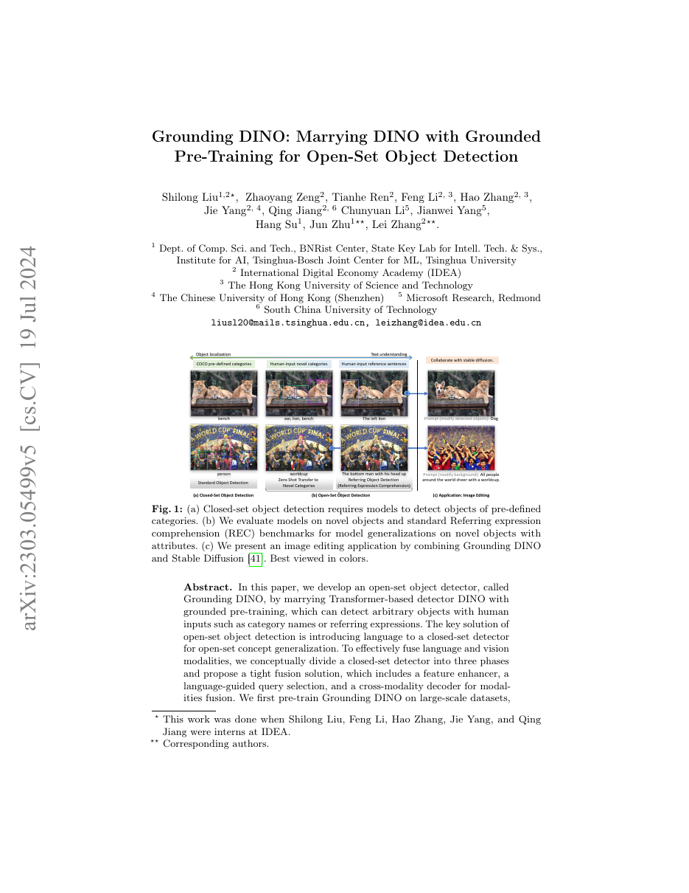

来源：图1，PDF第1页，面板(a)—(c)，原页保留图注。对应来源记录 P0001。

**读图顺序：**先看(a)固定类别检测，再看(b)类别名称和指代表达，最后看(c)检测与生成模型结合的编辑示例。

- **固定类别检测：**类别集合预先确定，例如 `person`、`bench`。输入图像，输出框和类别。
- **开放词汇检测：**用户可以改变类别文本，例如 `lion . ear . bench .`，模型输出对应对象的位置。
- **指代表达理解（REC）：**输入如 `the left lion`，需要在同类对象中找出满足描述的那个实例。
- **图像编辑：**检测框帮助后续模型确定编辑区域；生成图片由 Stable Diffusion 等模型完成。

**教学例子，非新增实验：**一张图有两只狗和一只猫。`dog . cat .` 要求找出相应类别的对象；`the dog on the left` 则要求从多只狗中识别唯一目标。后者多了属性和关系约束，因此不能用类别检测的高 AP 代替指代理解能力。

### 2.3 两个口径必须先说清

**第一，本文的“零样本”是数据集迁移口径。**论文第2页脚注定义为：训练过程未使用被测试数据集的训练划分。它不要求测试类别的语义概念从未在其他预训练数据出现。第9页指出 Objects365 几乎覆盖 COCO 类别，因此 COCO 零样本52.5 AP不能直接解释为“对完全没见过的类别达到52.5 AP”。

**第二，本文对几个任务名称采用了宽泛约定。**作者将 open-set、open-world、open-vocabulary detection 在本文中视为同一任务。汇报时可以沿用作者说法，但应描述具体协议；本文没有因此建立完善的未知类发现或未知目标拒识机制。

## 3. 必要背景：DINO、GLIP 与 Grounding

| 概念 | 初次接触时的解释 | 与本文的关系 |
|---|---|---|
| 目标检测 | 同时判断“是什么”和“在哪里” | 输出类别/短语及矩形框 |
| Grounding，视觉定位 | 将文字中的词或短语对应到图像区域 | 将检测统一成区域—文本对齐问题 |
| DETR 类检测器 | 用一组可学习对象查询，直接预测一组目标框 | 本文继承的检测范式 |
| 对象查询（object query） | 一个会从图像中检索对象信息的候选表示，包含内容与位置部分 | 不等于文本词，也不等于已经确定的真实目标 |
| DINO | 本文所用的、基于改进去噪锚框的 DETR 检测器 | 提供强检测基座；不要与同名视觉自监督模型混淆 |
| GLIP | 将目标检测改写为短语定位，进行大规模区域—文本预训练 | 提供重要训练路线和比较基线 |
| Swin / BERT | 分别编码图像和文本的骨干网络 | 本文采用的双编码器 |
| 交叉注意力 | 用一组表示作为查询，从另一组表示中读取相关信息 | 让图像、文本和对象候选发生交互 |

**研究脉络：**DINO 提供准确的框预测，但原有类别头固定；GLIP 展示了区域—文本预训练的价值。Grounding DINO 将二者结合，并让语言进入三个融合接口。作者并非首次提出“用语言做检测”，其主要贡献是具体的融合设计、文本表示和系统验证。（PDF第2—7页）

**过渡句：**“知道了检测器需要语言以后，下一步不是只加一个文本编码器，而是看语言能不能真正改变检测过程中关注的区域。”

## 4. 方法主线：沿着一张图走完一次检测

### 4.1 图3：整体框架与三个融合位置

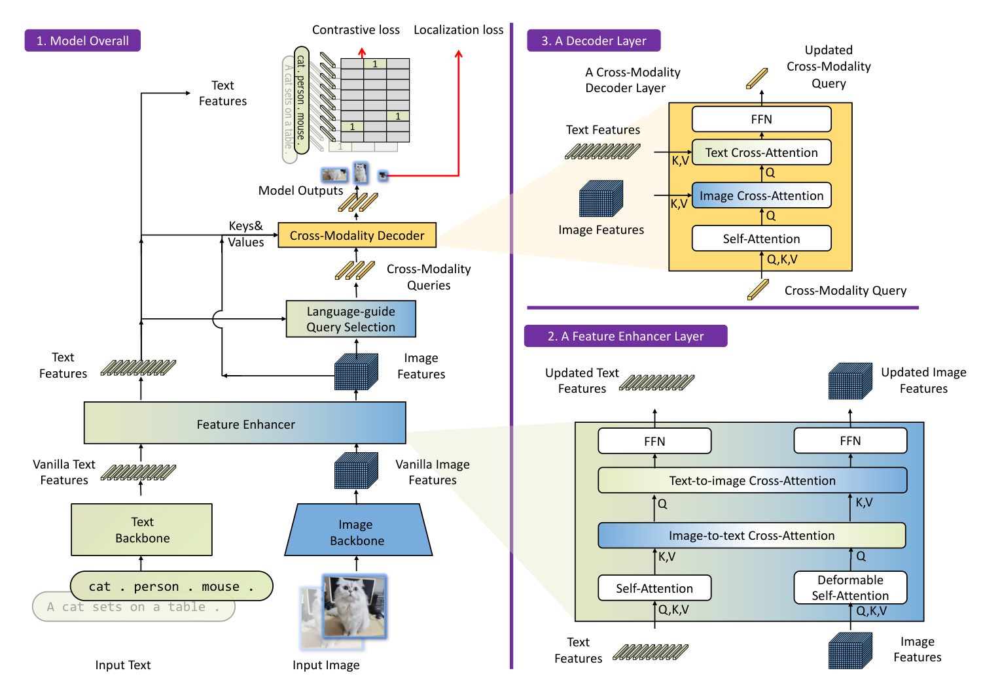

来源：图3，PDF第5页，左侧整体结构、右下特征增强层、右上解码层均已查看；[完整原页及图注](组会资料/assets/page_5.png)。原图注：The framework of Grounding DINO. We present the overall framework, a feature enhancer layer, and a decoder layer in block 1, block 2, and block 3, respectively.

**建议指图顺序：左下输入 → 左中融合 → 查询选择 → 左上输出 → 右下增强层 → 右上解码层。**

| 步骤 | 输入 | 执行什么操作 | 输出交给谁 |
|---|---|---|---|
| 1. 双分支编码 | 图像和检测文本 | Swin 提取多尺度图像特征，BERT 提取文本词元特征 | 特征增强器 |
| 2. 特征增强 | 初始图像、文本特征 | 各模态自注意力，以及双向图文交叉注意力 | 查询选择器与解码器 |
| 3. 语言引导查询选择 | 增强后的图文特征 | 计算位置—词元匹配分数，选前900个视觉位置 | 初始化解码器的位置查询 |
| 4. 跨模态解码 | 对象查询及增强后的图文特征 | 查询自注意力、图像交叉注意力、文本交叉注意力和前馈网络，逐层更新 | 预测头 |
| 5. 输出 | 最后层对象查询 | 预测框，计算查询与文本词元的匹配得分 | 多个框和短语；REC取最高分框 |

**“三阶段”对应步骤2、3、4，不是仅在最后一步用文本给框起名字。**

### 4.2 D01：特征增强——先建立区域与文字的联系

图像特征使用可变形自注意力，文本使用普通自注意力；双向交叉注意力让视觉位置读取相关文本，也让文本读取视觉证据。特征增强器有6层。

**我的理解：**图像分支回答“这里有什么视觉线索”，文本分支回答“当前要找什么”，交互后得到与本次文本条件有关的表示。可行替代是让图文独立编码、只在输出时匹配；它更晚引入语言，难以在早期改变候选特征。其效果需要实验比较，不能只凭结构图判定。

### 4.3 D02：查询选择——把有限候选分配给语言相关位置

先算每个图像位置与每个文本词元的相关性，再按每个位置的最高相关性选出900个位置。**900是送入解码器的候选数，不是固定输出900个有效目标。**

这里继承 DINO 的混合初始化：位置部分用编码器输出的动态锚框初始化，内容部分是可学习查询。不能笼统地说“把筛选出的文本特征直接当作900个查询”。精确计算见第5节。（PDF第7页）

### 4.4 D03：跨模态解码——细化框时继续读取语言

每一层依次进行：查询之间自注意力 → 查询读取图像 → 查询读取文本 → 前馈网络。共6层；与原始 DINO 解码层相比，关键新增项是文本交叉注意力。

**可以这样讲：**“第一次选中的只是值得关注的位置。后续每次调整候选表示和框时，模型还会继续看文字，因此语言条件贯穿细化过程。”

结构上支持持续交互，但并不能由此证明模型已经掌握复杂关系推理；是否有效要看消融和 REC 结果。

### 4.5 图4 / D04：子句级文本表示——隔离独立类别，保留内部语义

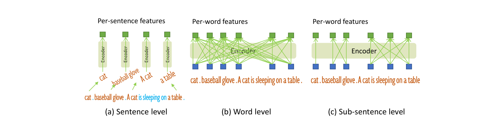

来源：图4，PDF第6页，面板(a)—(c)；[完整原页](组会资料/assets/page_6.png)。原图注：Comparisons of text representations.

从左到右读：

1. **句子级：**把一个短语/句子压成一个表示，细粒度词信息受限。
2. **普通词级：**保留各词元，但任意拼接的类别之间会相互注意。
3. **子句级：**保留词元表示，用注意力掩码隔离无关类别片段，同时保留片段内部关系。

例如 `cat . baseball glove . A cat is sleeping on a table .`，`baseball glove` 内部需要联系，`cat` 与独立类别 `baseball glove` 之间则没有必要因拼接顺序而产生上下文依赖。这里屏蔽的是无关文本片段间的交互，图文融合仍然保留。

**本节收束句：**“三个融合模块解决语言何时进入检测器的问题，子句掩码解决类别文本如何组织的问题；两者分别作用于跨模态交互和文本内部表示。”

## 5. 必要公式与训练方式

### 5.1 查询选择公式：只需讲清矩阵和两个操作

论文公式(1)，PDF第7页；下面按索引重写，含义与原式一致：

$$
X_I\in\mathbb{R}^{N_I\times d},\quad
X_T\in\mathbb{R}^{N_T\times d},\quad
S=X_I X_T^\top\in\mathbb{R}^{N_I\times N_T},
$$

$$
s_i=\max_{1\le j\le N_T}S_{ij},\qquad
I_{N_q}=\operatorname{TopKIndices}_{N_q}(s),\qquad N_q=900.
$$

| 符号/操作 | 含义 |
|---|---|
| $N_I$ | 多尺度图像特征展平后的位置数，论文称通常超过一万 |
| $N_T$ | 文本词元数，设定最大文本长度为256 |
| $d$ | 共同特征维度，设为256 |
| $S_{ij}$ | 第$i$个图像位置与第$j$个文本词元的点积匹配分数 |
| 对文本维取最大值 | 每个图像位置保留最相关的那个词元分数 |
| 对视觉位置取Top-K | 在全部位置中选出900个位置索引 |

**教学数值例子，不是论文实验：**三个位置对 `dog`、`cat` 的分数分别是 $(0.9,0.1)$、$(0.2,0.8)$、$(0.3,0.2)$。取最大值得到 $0.9,0.8,0.3$；若只选两个位置，就选前两个。

**能推出什么：**输入文本改变时，候选位置排序可以改变；并不是给每个类别平均分配固定候选数。**不能推出什么：**最大值操作本身没有显式要求同一候选同时满足颜色、位置和关系约束。因此“左边的红色杯子”能否准确定位仍须验证。后一句是公式层面的分析，不是作者测得的因果机制。

### 5.2 区域—词元对齐：检测数据如何变成定位训练数据

普通检测标注中的类别编号，可转为文本里的对应词元。例如真实框标签是 `cat`，文本为 `cat . dog .`，训练时将这个框与 `cat` 对应词元关联，而非要求模型只从一个永久固定的类别编号表中分类。

论文使用三类数据（PDF第19—20页）：

| 数据类型 | 原有监督 | 如何进入统一框架 | 需要注意 |
|---|---|---|---|
| 检测数据 | 目标框与类别 | 拼接类别名称，建立框—词元对应 | 包括 O365、OI，以及部分配方中的 COCO |
| 定位数据 | 图像、短语和对应区域 | 直接学习区域—文本对齐 | GoldG来自 Flickr30k Entities 和 Visual Genome；RefC指三套 RefCOCO 数据 |
| 图像描述数据 | 图像和描述 | 使用 GLIP 生成伪框后训练 | Cap4M依赖教师覆盖与标注质量；不是无框监督凭空变成真实框 |

T使用约60万图像的 O365v1，L使用约170万图像的 O365v2。T、L对比同时改变了骨干和数据，不能把全部收益归为模型变大。

### 5.3 训练损失：先匹配，再监督

模型产生一组预测，真实框数量则随图像变化。匈牙利匹配先找到预测与真实框的对应关系，再计算分类与定位损失，并处理未匹配预测。编码器输出和各解码层另有辅助监督。

根据正文第9页的权重，主损失可概括为：

$$
\mathcal L=\mathcal L_{\rm cls}+5\mathcal L_{\rm L1}+2\mathcal L_{\rm GIoU}.
$$

这是对损失构成的概括，不展开所有层的辅助项。$\mathcal L_{\rm cls}$对查询—文本词元点积产生的得分使用焦点损失；$\mathcal L_{\rm L1}$惩罚框坐标偏差；$\mathcal L_{\rm GIoU}$衡量框的几何匹配。不要把这里的区域—词元对齐直接讲成 CLIP 的整图—整句损失。

**复现注意：**正文的匹配代价权重为2、5、2，最终损失权重为1、5、2；附录表8却列分类匹配系数1、分类损失系数2，二者互换。本稿保留这一冲突；实际训练须核对所选版本的代码配置，不能声称已经确定正确系数。

## 6. 关键实验：效果、来源与边界

### 6.1 先建立评测地图

| 基准 | 主要考察什么 | 读什么指标 | 最容易误读的地方 |
|---|---|---|---|
| COCO | 常见类别的迁移与微调 | AP | 把目标数据集未训练当作语义类别从未见过 |
| LVIS | 大词汇、长尾类别 | 总AP及稀有/常见/高频类别AP | 总AP提高掩盖稀有类落后 |
| ODinW35 | 35个不同数据集的跨域表现 | 数据集AP的平均数与中位数 | 汇总分数高就认为每个专业领域都可用 |
| RefCOCO/+/g | 从描述中定位唯一实例 | Top-1定位准确率 | 将检测AP和准确率混比，将任务训练结果称作直接迁移 |

**AP怎么讲：**它综合预测排序下的准确率与召回率；COCO式主AP还对多个IoU阈值平均。IoU是预测框与真实框交集面积除以并集面积。52.5 AP不是“52.5%的图片检测正确”，也不是模型输出的置信度。REC按首选框定位是否成功统计，和检测AP不同。

### 6.2 表2：COCO——先看受控比较，再看52.5 AP

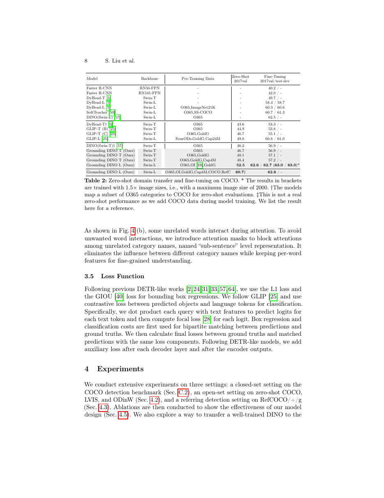

来源：表2，PDF第8页，P0008；下表为便于讲解的节选，微调列统一采用val结果。

| 模型 | 预训练数据 | COCO直接迁移AP | COCO微调AP |
|---|---|---:|---:|
| DINO-T | O365 | 46.2 | 56.9 |
| GLIP-T(B) | O365 | 44.9 | 53.8 |
| Grounding DINO T | O365 | 46.7 | 56.9 |
| GLIP-T(C) | O365+GoldG | 46.7 | 55.1 |
| Grounding DINO T | O365+GoldG | 48.1 | 57.1 |
| Grounding DINO T | O365+GoldG+Cap4M | 48.4 | 57.2 |
| Grounding DINO L | O365+OI+GoldG | **52.5** | 62.6 |

**建议讲三层：**

1. O365与Swin-T条件下，相比DINO提高0.5 AP，相比GLIP提高1.8 AP；强检测基座本身贡献很大。
2. 同为Grounding DINO T，加GoldG由46.7到48.1，提高1.4 AP，说明区域—文本训练有额外价值。
3. L达到52.5 AP，但骨干、O365版本和混合数据等共同变化，这个数字展示系统能力，不能孤立证明某个模块贡献。

**三项不能混入：**加入COCO训练的L得到60.7 AP，原表明确标记不是真正COCO零样本结果；62.6 AP属于COCO微调；括号内63.0 AP还使用扩大输入尺寸的设置。它们回答的不是同一个问题。

### 6.3 表7：消融——哪些设计确实有用？

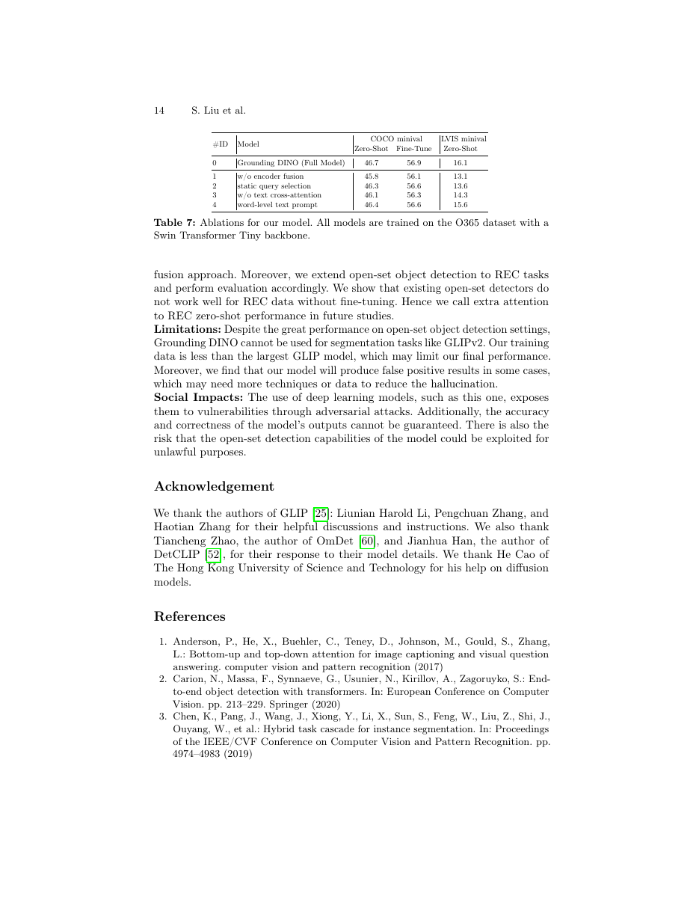

来源：表7，PDF第14页，P0014。全部变体使用O365与Swin-T；不要与O365+GoldG的LVIS结果混用。

| 变体 | COCO直接迁移AP | COCO微调AP | LVIS直接迁移AP | LVIS相对完整模型下降 |
|---|---:|---:|---:|---:|
| 完整模型 | 46.7 | 56.9 | **16.1** | — |
| 移除编码器图文融合 | 45.8 | 56.1 | 13.1 | 3.0 |
| 静态查询选择 | 46.3 | 56.6 | 13.6 | 2.5 |
| 移除文本交叉注意力 | 46.1 | 56.3 | 14.3 | 1.8 |
| 普通词级文本提示 | 46.4 | 56.6 | 15.6 | 0.5 |

**C01 / E01：**逐项去除都带来下降，支持三个融合位置和子句表示在该完整系统中的作用；LVIS比COCO更明显地暴露语言相关设计的影响。

**边界：**这些是完整系统周围的逐项消融，差值不能相加为总贡献；缺少所有模块组合，无法排除模块交互。原文第13页将查询选择的LVIS增益写作3.0 AP，但按表7应为 $16.1-13.6=2.5$ AP，汇报采用表格值。小幅提升也没有多随机种子区间支持。

### 6.4 表3：LVIS——总分提高，稀有类别仍然落后

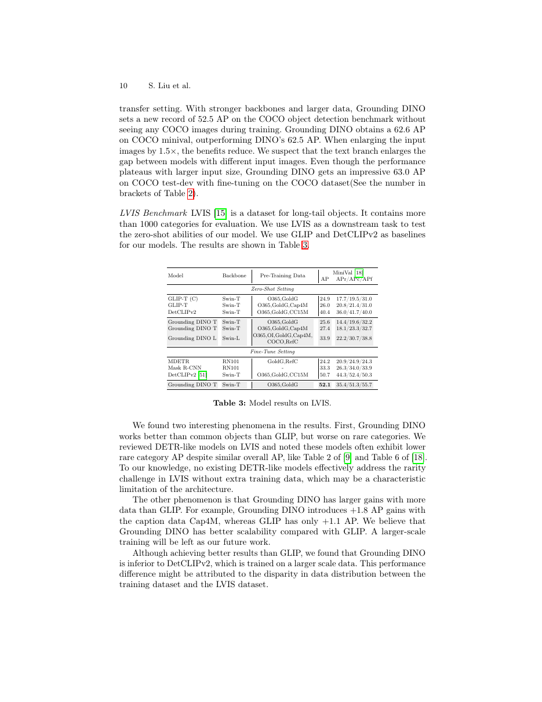

来源：表3，PDF第10页，P0010。重点看零样本部分中的AP与APr两列。

| 模型 | 数据配方 | 总AP | 稀有类APr |
|---|---|---:|---:|
| GLIP-T(C) | O365+GoldG | 24.9 | **17.7** |
| Grounding DINO T | O365+GoldG | **25.6** | 14.4 |
| GLIP-T | 再加Cap4M | 26.0 | **20.8** |
| Grounding DINO T | 再加Cap4M | **27.4** | 18.1 |
| DetCLIPv2-T | O365+GoldG+CC15M | 40.4 | 36.0 |

**C02 / E02：**两组比较中，Grounding DINO总AP更高，稀有类却更低，说明总体提升不等于长尾问题解决。DetCLIPv2零样本表现更高，但额外数据不同；不能据此单独归因架构优劣。Grounding DINO经LVIS微调可达52.1 AP，说明目标域适配有效，不能反推直接迁移已经充分。

### 6.5 表4：ODinW——平均与中位都看，仍要检查具体领域

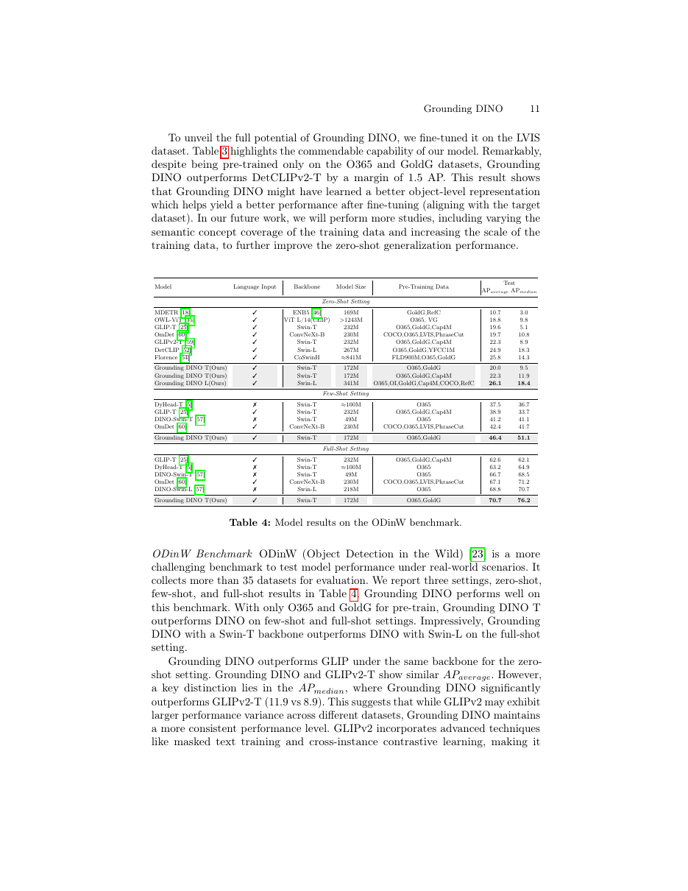

来源：表4，PDF第11页，P0011。以下仅比较零样本部分。

| 模型 | 训练配方 | 平均AP | 中位AP |
|---|---|---:|---:|
| GLIP-T | O365+GoldG+Cap4M | 19.6 | 5.1 |
| GLIPv2-T | O365+GoldG+Cap4M | 22.3 | 8.9 |
| Grounding DINO T | O365+GoldG | 20.0 | 9.5 |
| Grounding DINO T | O365+GoldG+Cap4M | 22.3 | 11.9 |
| Grounding DINO L | O365+OI+GoldG+Cap4M+COCO+RefC | 26.1 | 18.4 |

**C03 / E03：**T与GLIPv2-T平均AP相同，中位AP更高，说明排序居中的数据集表现更好；仅凭这两个统计量不能严格证明方差更小。表18的PlantDoc反例为Grounding DINO T 0.36 AP、GLIP-T 1.10 AP（两者O365+GoldG+Cap4M）。整体优势不能保证专业病害类别可用。

46.4 AP和70.7 AP分别是T在ODinW少样本和全样本训练下的平均结果，属于目标任务适配，不能并入上表零样本排名。

### 6.6 表5：REC——会找“人”，不等于理解“左边戴眼镜的人”

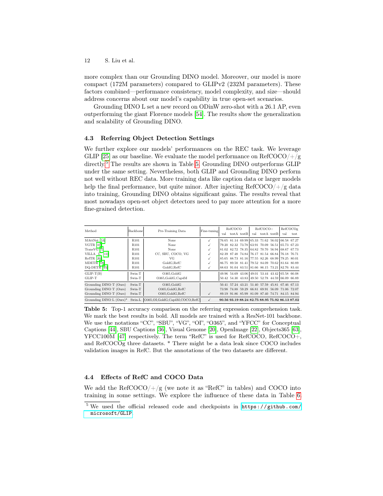

来源：表5，PDF第12页，P0012。以下节选RefCOCO验证集Top-1准确率；表中的微调标记必须保留。

| 模型及训练情况 | 任务微调标记 | RefCOCO val |
|---|---|---:|
| GLIP-T，O365+GoldG | 无 | 49.96 |
| Grounding DINO T，O365+GoldG | 无 | 50.41 |
| Grounding DINO T，O365+GoldG+RefC | 无 | 73.98 |
| Grounding DINO T，O365+GoldG+RefC | 有 | 89.19 |

**C04 / E04：**没有REC数据时优势有限，加入RefC及任务微调后才大幅提高。表5中预训练数据文字相同的后两行不是同一实验，不能把73.98到89.19解释为只增加了相同那一份数据。

作者在附录D.3给出的解释是：REC通常一条表达只对应一个框，而一般定位预训练可能鼓励输出多个对象。**这是作者提出的目标错配解释；并非已经独立证实它是唯一原因。**L模型最佳行还注明COCO与RefC可能有图像重叠，标签不同也不能自动消除泄漏影响。

### 6.7 表6：数据加得更多，能力并不全面上升

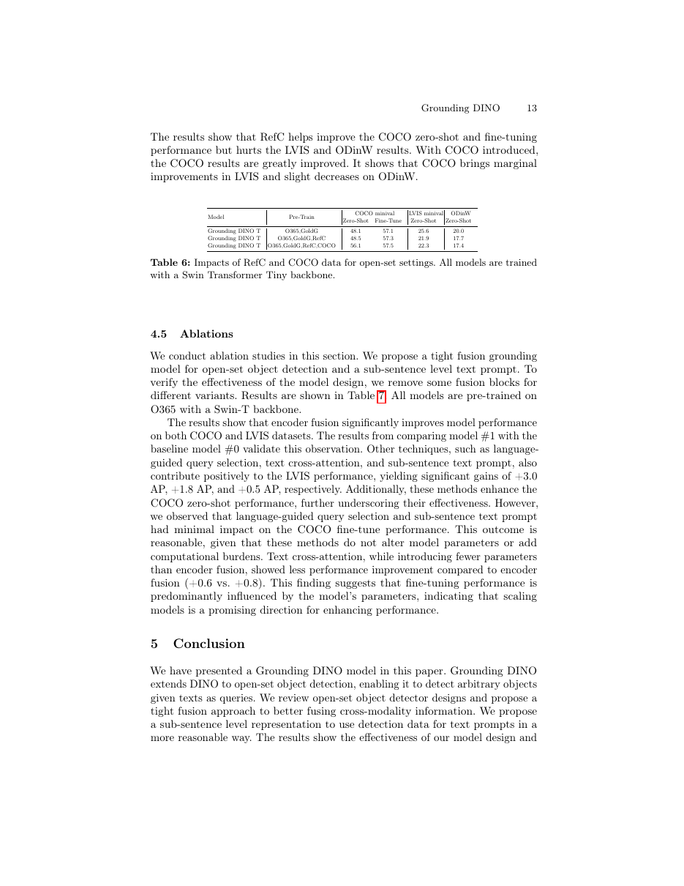

来源：表6，PDF第13页，P0013；均为Grounding DINO T。

| 训练数据 | COCO直接评估AP | LVIS直接评估AP | ODinW直接评估AP |
|---|---:|---:|---:|
| O365+GoldG | 48.1 | 25.6 | 20.0 |
| 加RefC | 48.5 | 21.9 | 17.7 |
| 再加COCO | 56.1* | 22.3 | 17.4 |

*最后一行COCO已参与训练，其56.1 AP不能当作严格COCO零样本结果。

**C05 / E05：**加RefC后COCO略升，LVIS和ODinW下降，提示训练分布与任务目标可能发生取舍。不能简化成“多模态数据越多，所有任务越好”；也不能由这一个实验断言所有指代数据都会损害泛化。

## 7. 我对论文的评价：贡献与证据边界

### 7.1 真正值得学习的三点

1. **设计思路：语言不仅用于分类，还参与候选资源分配。**特征、候选初始化和解码三个接口形成清楚的改造路径，表7提供局部受控证据。
2. **训练接口：用区域—文本对齐连接不同类型数据。**该路线继承GLIP，本文的价值在于与DINO的系统结合及具体改进。
3. **评估意识：用REC和跨域结果检验“开放”的含义。**结果本身提醒我们，类别命名、长尾视觉知识和关系理解是不同能力。

### 7.2 证据卡：每个主张最多讲到哪里

| 主张 | 依据 | 支持程度与限制 |
|---|---|---|
| C01：三阶段融合有用 | E01：表7 | 在给定训练配方的完整系统周围得到支持；不能量化独立可加贡献 |
| C02：长尾尚未解决 | E02：表3 | 稀有类落后有直接数值证据；具体原因未被完全分离 |
| C03：跨域总体较强 | E03：表4及表18 | 支持汇总优势；专业领域仍可能接近失效 |
| C04：细粒度指代需要额外学习 | E04：表5、附录D.3 | 本文设置支持；不等于证明模型永远不能零样本理解关系 |
| C05：数据配方存在能力取舍 | E05：表6 | 当前对照支持；不应推广为普遍规律 |

### 7.3 尚未解决的问题

- **收益归因：**L的强结果同时依赖数据、骨干和资源，架构贡献不能仅靠最终最高分证明。
- **可靠拒识：**作者承认会误检，论文没有给出“不存在所提示目标时”可靠拒识的系统保证。
- **复杂语言：**名称可输入不代表视觉知识充分，更不保证多对象关系约束被正确执行。
- **统计不确定性：**主表缺少多次独立运行区间，小幅AP差值需要重复实验确认。
- **功能边界：**模型输出框和短语，本身不输出像素级分割掩码；图像编辑效果还依赖外部生成模块。
- **复现确定性：**正文与附录参数冲突、不同检查点的数据配方差异，都需要落实到实际配置。

**建议使用的评价句：**“我认为最有价值的是把语言条件落实到检测过程的三个接口。实验支持这种融合设计，但开放词汇能力仍受训练覆盖和监督目标影响，尤其是长尾类别与细粒度指代。”

## 8. 未来研究启示

以下是基于本文证据提出的分析建议，未执行，也未做全面新颖性检索。

### 8.1 从提示稳定性切入，而非直接扩大模型

依据D04与E01，子句掩码试图降低无关类别间的干扰。可以进一步问：同义词、类别顺序、无关类别数量改变时，同一目标的预测是否稳定？如果波动主要发生在候选阶段，后续可研究候选分配；若候选稳定而最终输出波动，则应重点检查解码或打分。

适用于需要稳定类别词表的场景。前提是各提示确实保持目标含义一致，且没有因为超过文本长度上限而截断目标词。

### 8.2 将“分类覆盖”与“关系理解”分开诊断

依据E02和E04，应把错误分为类别未识别、框定位不准、同类实例选错、属性/关系理解错误。只看总体AP难以知道该补类别数据、定位监督还是关系监督。这个方向适用于同类多实例场景；需要可核查的人工标注，不能把模型自己的输出作为真值。

### 8.3 研究不存在目标时的误检

依据作者局限性说明，可以加入图中不存在的类别提示，检查阈值改变时真实目标召回与误报的取舍。该检查适合自动标注或编辑管线，因为错误框会传递到后续步骤。不能只用“分数下降”证明拒识改善，要在固定召回或固定误报条件下比较。

## 9. 下一步研究规划：第一次组会后先做什么

这是通用计划，假设后续能够取得一个作者检查点、合适推理设备及少量可标注图像；目前没有执行。**优先做A01，因为它成本较低，能先确定模型在具体输入下是否可用。**

| 优先级 | 问题与假设 | 方法和对照 | 所需资源及交付物 | 如何决定下一步 |
|---|---|---|---|---|
| A01：先建立诊断基线 | 固定检查点下，提示表达是否显著影响同一目标？依据E01、E03 | 固定图像、预处理和阈值，比较原类别名、合理同义词、顺序扰动、加入无关类别；记录召回、误检及框匹配 | 权重、推理环境、人工框；先做小规模试验，样本量按错误覆盖估计；交付输入、参数和输出可追溯的案例表 | 若只改提示就频繁漏检或选错，先定位提示/候选问题；若稳定，再测目标领域覆盖 |
| A02：再区分错误来源 | 关系条件是否比单类别命名更易失败？依据E04 | 同图对照类别名、属性表达和关系表达，人工确认唯一正确目标；保持检查点与评分方式一致 | 同类多实例图像、描述与框；交付分组Top-1准确率及错误分类 | 若主要是同类实例选错，考虑关系数据或任务监督；若类别本身失败，先补覆盖诊断 |
| A03：按前两步结果检查拒识 | 负提示是否产生高分误检？依据局限性 | 加入人工确认不存在的目标，扫阈值，在相同真实目标召回下比较误报；保留验证/测试划分 | 正负提示集；交付召回—误报曲线和阈值记录 | 若误报可由阈值控制且召回代价可接受，再验证新域；否则研究校准或显式拒识 |

不预设“提高几个百分点”作为成功标准。先通过试验估计波动、失败类型和资源需求，再确定正式样本量及可接受阈值。大规模重训和论文式创新应在诊断与相关工作检索之后讨论。

## 10. 组会可能被问到的问题

### Q1：它与DINO最本质的区别是什么？

DINO提供检测基座；Grounding DINO加入文本编码器、图文特征融合、语言引导查询选择和解码器文本交叉注意力，并用区域—词元对齐进行训练，使文本成为可变化的检测条件。

### Q2：为什么不用CLIP给检测框分类就够了？

按本文动机，整图—文本预训练与区域—文本定位存在粒度差异；Grounding DINO还希望文字改变早期特征和候选选择。要证明相对“框后分类”的优势，需要相同预算和数据的对照，不能只凭动机下结论。

### Q3：为什么是900个查询？可以改成类别数吗？

论文沿用DINO的900个查询。查询表示潜在对象候选，不与类别一一对应，同类可以有多个实例。附录表15增加到1200、1500后总体收益很小，见第11节。

### Q4：52.5 AP说明完全没见过的新类别都能识别吗？

不能。本文主要是目标数据集训练划分未参与训练的迁移口径，O365几乎覆盖COCO类别；需要另行控制语义类别重叠，才能讨论严格未见类别泛化。

### Q5：创新主要是网络，还是更多训练数据？

二者都有。表7支持模块在固定配方中的价值；加GoldG也有收益。L的最终成绩则同时改变骨干、数据和资源，不能全部归于网络设计。

### Q6：为什么加入RefC后有的检测任务变差？

表6给出退化现象；作者用指代数据与普通定位数据的监督目标不同解释。训练分布、采样和优化也可能参与影响，本文没有把这些原因逐一隔离。

### Q7：能做分割、生成图片或直接对话吗？

论文中的检测器输出框和短语；分割、生成和对话不是其原生输出。图像编辑演示是与Stable Diffusion或GLIGEN组合的系统结果。

### Q8：这个工作对我的研究有什么启发？

可先借鉴三个接口的分析方式：特征是否对齐、候选是否受目标条件引导、细化过程中条件是否仍然可用。具体是否需要改模型，先用第9节诊断实验决定，避免在不知道错误来源时直接重训。

### Q9：我们已经复现到什么程度？

目前完成的是材料审阅、原文核对和讲解准备，没有进行模型推理或训练复现。下一步计划与已完成结果应明确分开。

## 11. 附录备查：参数、补充实验与图表导航

### 11.1 训练设置与复现优先核对项

| 项目 | 论文报告 |
|---|---|
| 图像/文本骨干 | T用Swin-T，L用Swin-L；文本用BERT-base |
| 隐藏维度、查询数、文本长度上限 | 256、900、256 |
| 特征增强层/解码层 | 6 / 6 |
| 优化器与学习率 | AdamW；主学习率$10^{-4}$，图像与文本骨干均$10^{-5}$ |
| 权重衰减、梯度裁剪、dropout | $10^{-4}$、最大范数0.1、0 |
| T训练资源 | 16张V100，全局批大小32 |
| L训练资源 | 64张A100，全局批大小64 |
| 来源 | 第9页与第19页表8；分类系数冲突见第5.3节 |

真正复现时还应记录：PDF和代码版本、权重文件、O365版本、混合数据配方、分词器、类别列表及分隔方式、图像尺寸、框和文本阈值、短语合并及评测配置。本文正文将分词概称为BPE；应固定实际BERT分词器，不据此自行替换实现。

### 11.2 表15：增加查询数没有解决稀有类问题

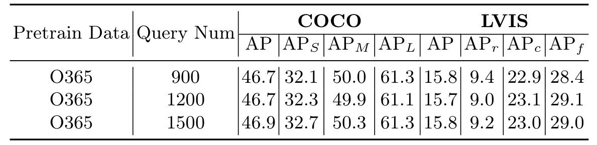

来源：表15，PDF第31页，P0031；[含表14、表15及图注的完整原页](组会资料/assets/page_31.png)。原图注：Results for Grounding DINO Tiny with more decoder queries.

| 查询数 | COCO AP | LVIS AP | LVIS稀有类APr |
|---:|---:|---:|---:|
| 900 | 46.7 | 15.8 | 9.4 |
| 1200 | 46.7 | 15.7 | **9.0** |
| 1500 | 46.9 | 15.8 | 9.2 |

这组结果不支持“增加查询数提高了稀有类AP”的直接表述。附录文字声称稀有类略升，与表15所列APr不一致。该表的900查询LVIS AP为15.8，与表7的16.1也不同，论文未在这些位置充分解释差异，不能视作完全相同的一组运行。

### 11.3 表9与表10：已有DINO权重可作为迁移起点

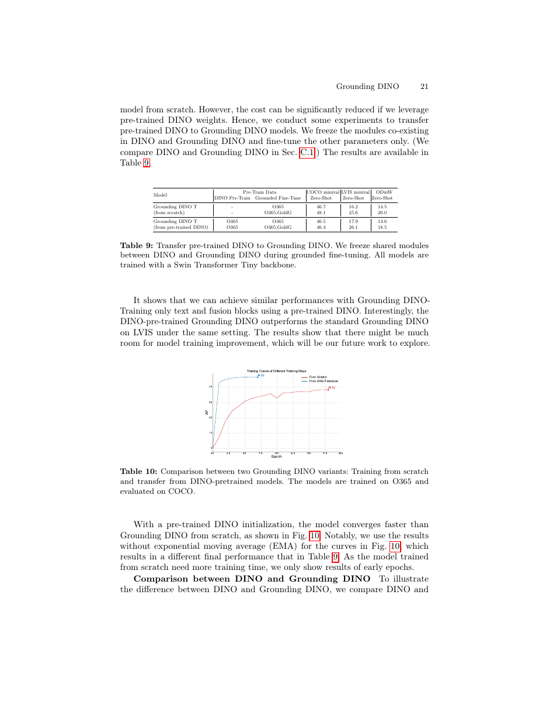

来源：PDF第21页，P0021，上部表9、下部标作表10的训练曲线及图注均保留。

作者冻结DINO和Grounding DINO共有模块，只训练新增模块。O365+GoldG条件下，从头训练的COCO/LVIS/ODinW为48.1/25.6/20.0，从DINO迁移为46.4/26.1/18.5：可复用已有权重，但不是各指标全面持平。下方曲线展示预训练初始化较快的早期收敛；曲线未用EMA且仅展示从头训练的早期阶段，不能与表9终值直接等同。

### 11.4 表11：增加语言模块并非所有设置都会提高AP

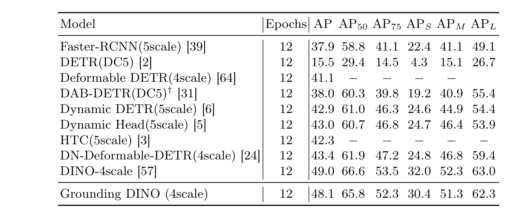

来源：表11，PDF第22页，P0022；[完整原页与图注](组会资料/assets/page_22.png)。比较为ResNet-50、COCO、12轮闭集训练。

DINO为49.0 AP，Grounding DINO为48.1 AP。作者推测新增模块使优化更难，但未提供独立因果验证。该结果限制了“加跨模态结构一定提升普通检测”的说法，也不否定其开放词汇任务价值。

### 11.5 表20：效率数字的适用范围

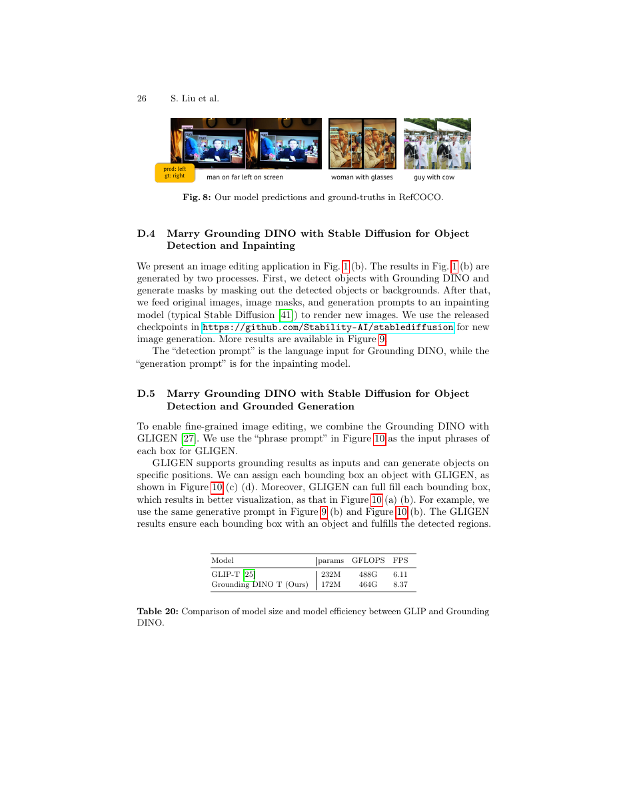

来源：表20，PDF第26页下部，P0026；上部图8与应用说明也保留。

| 模型 | 参数量 | 计算量 | FPS |
|---|---:|---:|---:|
| GLIP-T | 232M | 488G | 6.11 |
| Grounding DINO T | 172M | 464G | 8.37 |

只能说明作者该评测环境中更小、更快；该页没有充分交代让人直接复现测速的全部设备与流程条件，不能当作本机或目标设备的实时性承诺。

### 11.6 其余图表如何按需查阅

以下是已审阅材料的导航，供问答使用；不把每个附录表再完整讲一遍。

| 原图表 | 所在页/原图入口 | 内容与本次用途 |
|---|---|---|
| 表1 | [原有图片](images/page_004_fig_table_1_review.png)，第4页 | 相关方法的融合位置、文本表示与已报告任务；并非其他方法的能力上限 |
| 图2 | [第2页](组会资料/assets/page_2.png) | A/B/C三个可融合接口的概念示意 |
| 表8、算法1 | [第19页](组会资料/assets/page_19.png)、[第20页](组会资料/assets/page_20.png) | 超参数、查询选择伪代码；注意系数和变量名问题 |
| 图5 | [原有图片](images/page_023_fig_fig_5_review.png)，第23页 | 蓝色表示相对DINO增加的模块 |
| 图6—7 | [第25页](组会资料/assets/page_25.png) | 检测案例与不同提示下的候选可视化；案例不代替系统量化 |
| 图8 | [第26页](组会资料/assets/page_26.png) | REC预测与真实框的差异，辅助理解多框/单实例目标错配 |
| 图9—10 | [第27页](组会资料/assets/page_27.png)、[第28页](组会资料/assets/page_28.png) | 与Stable Diffusion、GLIGEN的组合，定位提示与生成提示职责不同 |
| 表12—14 | [第29页](组会资料/assets/page_29.png)、[第30页](组会资料/assets/page_30.png)、[第31页](组会资料/assets/page_31.png) | ODinW35逐数据集明细；配方分别是T基础、T加Cap4M、L完整混合配方 |
| 表16 | [第32页](组会资料/assets/page_32.png) | BERT-B/L比较；仅限特定初始化与18轮训练，不能证明语言分支永远不是瓶颈 |
| 表17 | [第32页](组会资料/assets/page_32.png) | Detic伪标注的oracle实验；教师见过LVIS，不能作为严格零样本证据 |
| 表18—19 | [第33页](组会资料/assets/page_33.png) | ODinW与GLIP的逐域对照；REC专门训练9轮的结果，均需保留训练条件 |

## 12. 审阅纠错、来源与结束语

### 12.1 汇报时需要避免的具体误读

| 位置 | 核对发现 | 本稿处理 |
|---|---|---|
| 已有笔记的表15解读 | 1200查询的稀有类APr写为9.7，原表为9.0 | 本稿使用9.0；原笔记保留未覆盖 |
| 原文第13页与表7 | 查询选择增益文字为3.0，表格相减为2.5 | 使用表格，并注明冲突 |
| 原文第9页与表8 | 分类匹配/损失系数分别为2/1与1/2 | 不替作者擅自确定正确配置 |
| 原文第23页与表15 | 文字称更多查询提升稀有类，表中APr未提升 | 以表格所列指标陈述结果 |
| 表5图注与表体 | 图注称所有模型用ResNet-101，但表中明确列有Swin-T/L | 按具体模型行读取骨干 |
| 算法1 | `logits_per_img_feat`定义与后续`logits_per_img_feature`引用不一致 | 视为伪代码变量名笔误；理解按点积→文本维最大值→视觉维Top-K |
| 表2、表6的COCO列 | 部分行已经使用COCO训练，却仍放在零样本相关列/区域 | 按每行真实数据配方判定，不照抄栏目称谓 |
| 目录登记文件 | `work.title`截断，顶层标题完整 | 论文身份采用PDF完整标题与arXiv编号 |

### 12.2 论文信息与来源

- **完整标题：**Grounding DINO: Marrying DINO with Grounded Pre-Training for Open-Set Object Detection。
- **作者：**Shilong Liu、Zhaoyang Zeng、Tianhe Ren、Feng Li、Hao Zhang、Jie Yang、Qing Jiang、Chunyuan Li、Jianwei Yang、Hang Su、Jun Zhu、Lei Zhang。
- **版本：**2023年首次预印本；本次依据本地arXiv:2303.05499v5，版本日期2024-07-19。文件名中的2023与PDF页眉的2024分别对应首次年份与版本日期。
- **原文入口：**[arXiv v5](https://arxiv.org/abs/2303.05499v5)。
- **作者代码入口：**[IDEA-Research/GroundingDINO](https://github.com/IDEA-Research/GroundingDINO)。本次未审计代码，链接供后续查阅。
- **本地原文：**[论文PDF](<Liu 等 - 2023 - Grounding DINO Marrying DINO with Grounded Pre-Training for Open-Set Object Detection.pdf>)。
- **原有笔记：**[论文2.zh-CN.md](论文2.zh-CN.md)。
- **查证记录：**[按页来源映射](组会资料/source/source_map.json)、[证据与计划记录](组会资料/evidence.json)。原文SHA-256：`ba1c64ec2ac4fedeb50b269eadc994456a8428dbe64a8dba2673f22df0fa20b3`。

### 12.3 可以直接使用的结束语

“这篇论文给我的主要启发，是让语言真正参与检测的特征、候选和细化三个阶段。消融实验支持这种设计，跨域和指代实验则说明开放词汇能力仍有明确边界。下一步我建议先固定检查点做提示稳定性与错误类型诊断，再判断应补充数据、调整候选选择，还是引入更有针对性的关系监督。”

---

分析采用 norman-paper-reading 技能｜作者：N同学｜小红书：N同学｜B站/抖音：耐心的N同学  
Analysis performed using the norman-paper-reading skill | Author: N同学 | Xiaohongshu: N同学 | Bilibili/Douyin: 耐心的N同学
