---
tags:
  - papers/论文2
  - 开放词汇检测
  - 视觉语言对齐
aliases:
  - Grounding DINO 精读
  - 基于定位预训练的开放集目标检测
date: 2026-11-05
arxiv_id: 2303.05499
---
# Grounding DINO：将 DINO 与定位预训练结合的开放集目标检测

## 核心信息

- 标题：Grounding DINO: Marrying DINO with Grounded Pre-Training for Open-Set Object Detection
- 标题翻译：Grounding DINO：将 DINO 与定位预训练结合，用于开放集目标检测
- 作者：Shilong Liu、Zhaoyang Zeng、Tianhe Ren、Feng Li、Hao Zhang、Jie Yang、Qing Jiang、Chunyuan Li、Jianwei Yang、Hang Su、Jun Zhu、Lei Zhang
- 机构：清华大学、IDEA、香港科技大学、香港中文大学（深圳）、微软研究院、华南理工大学
- 发表时间：2023 年首次预印本；本次阅读版本为 2024-07-19 的 v5
- arXiv：2303.05499v5
- 论文链接：[arXiv 版本页面](https://arxiv.org/abs/2303.05499v5)
- 代码 / 项目：[IDEA-Research/GroundingDINO](https://github.com/IDEA-Research/GroundingDINO)
- 论文类型：人工智能方法论文

## 原文摘要翻译

本文将基于 Transformer 的检测器 DINO 与定位预训练结合，开发了名为 Grounding DINO 的开放集目标检测器。

它能够根据类别名称或指代表达等人工输入检测任意对象。开放集目标检测的关键是在封闭集检测器中引入语言，以实现开放集概念泛化。

为有效融合语言和视觉模态，作者在概念上将封闭集检测器分成三个阶段，提出包含特征增强器、语言引导的查询选择以及跨模态解码器的紧密融合方案。作者首先在包含目标检测数据、定位数据和图像描述数据的大规模数据集上预训练模型，然后在开放集目标检测和指代目标检测基准上评估。

该模型在 COCO、LVIS、ODinW 和 RefCOCO/+/g 等基准所覆盖的三类设置中表现良好。

在 COCO 零样本检测基准上达到52.5 AP，在 ODinW 零样本基准上以平均26.1 AP创下当时的新纪录。

作者发布了部分检查点和推理代码。

## 创新点

1. **把语言融合布置到检测流程的三个阶段。** 不仅在特征层融合图文，还让语言参与候选查询选择和解码器逐层细化；这使语言能够同时影响“看什么”和“如何调整候选框”。
2. **以区域与词元对齐统一检测和短语定位。** 用输入类别文本替代固定类别分类头，检测数据、定位数据和伪标注图像描述可进入同一训练框架。论文继承并改进 GLIP 的定位预训练路线，不能将这一训练思想全部视作原创。
3. **使用子句级文本表示。** 在保留词元特征的同时，屏蔽独立类别名称之间的注意力，减少任意拼接类别引入的无意义上下文依赖。
4. **将细粒度指代任务纳入评估。** 实验不仅给出开放类别检测的收益，也暴露了类别定位能力与属性、关系理解之间的差距。

## 一句话总结

Grounding DINO 用三阶段图文融合把 DINO 改造成语言条件检测器，但跨域收益依赖训练数据覆盖，强类别检测也不等于强零样本指代理解。

## 研究问题

### 从固定类别头到语言指定目标

封闭集检测器的分类维度由训练标签固定；换成新类别时，类别编号本身没有语义。本文要求输入一张图像与一段文字，输出框和对应短语，让文字成为可变化的检测条件。文字既可以是多个类别名称，也可以是包含属性或空间关系的指代表达。

核心设计问题是语言在检测器的哪一处发挥作用。GLIP 主要在特征增强阶段融合，部分 DETR 扩展使用语言构造查询。作者将融合位置划为特征增强、查询初始化、检测头三处，利用 Transformer 模块之间结构上的兼容性实现完整交互。本文的比较依据是原论文所评估的设置，不代表其他方法不能扩展到这些任务。（正文第2—4页）

## 数据与任务定义

### 输入输出和评测口径

| 任务 | 文本输入 | 输出与评测 | 必须区分的条件 |
|---|---|---|---|
| COCO 检测 | 类别名称串 | 多个框及文本标签；AP | 零样本迁移与 COCO 微调不同 |
| LVIS 长尾检测 | 大量类别名称 | 总 AP 与稀有、常见、高频类别 AP | 总分提高可能掩盖稀有类退化 |
| ODinW 跨域检测 | 各数据集类别 | 35 个数据集上的平均及中位 AP | 平均值不能代表每个领域可用 |
| RefCOCO/+/g 指代定位 | 一条描述表达 | 取最高分框，报告第一候选准确率 | 加入 RefC 训练与直接迁移不同 |

这里的 COCO“零样本”主要指没有用 COCO 图像训练，并不要求其语义类别完全未见。

Objects365 几乎覆盖 COCO 类别；作者甚至把预训练 DINO 的类别映射到 COCO，构造一个没有语言分支的迁移基线。

因而 52.5 AP 不能直接解释成对完全未知概念的检测能力。（第9页及表2）

### 预训练数据与模型配方

检测数据包括 Objects365、OpenImages，部分设置还加入 COCO。

GoldG 包括 Flickr30k Entities 与 Visual Genome 的定位数据。

RefC 指 RefCOCO、RefCOCO+、RefCOCOg 三套指代定位数据。

Cap4M 使用 GLIP 产生的伪框标注，T 和 L 分别使用 GLIP-T、GLIP-L 对应的数据。

伪标签意味着它继承了教师的覆盖与误差。

T 使用约 60 万图像的 Objects365 v1；L 使用约 170 万图像的 v2。这使大小模型的比较同时改变骨干、数据和训练资源，不能用于单独归因模型规模。不同表格中的 L 模型配方也不同，必须按每一行读取，不能拿一个“最强检查点”代表所有零样本结果。（附录第20页）

## 方法主线

### 机制流程

1. **编码与增强：** 图像进入 Swin 多尺度骨干，文字进入 BERT；特征增强器执行视觉可变形自注意力、文本自注意力以及双向交叉注意力，输出对齐后的图文特征，交给查询选择器和解码器。
2. **语言引导候选选择：** 计算每个视觉位置与所有文本词元的相似度，取该位置的最大词元分数，再选前 900 个视觉位置；其编码器输出初始化动态锚框位置，送入检测解码器。
3. **跨模态逐层细化：** 查询依次经过查询自注意力、图像交叉注意力、文本交叉注意力和前馈网络；重复六层，更新对象表示和位置。
4. **预测与任务适配：** 最后查询预测边界框，并与文本词元计算分类得分；检测任务返回多个框与短语，指代定位选择最高分框。训练时匹配真实框后施加分类和定位损失。

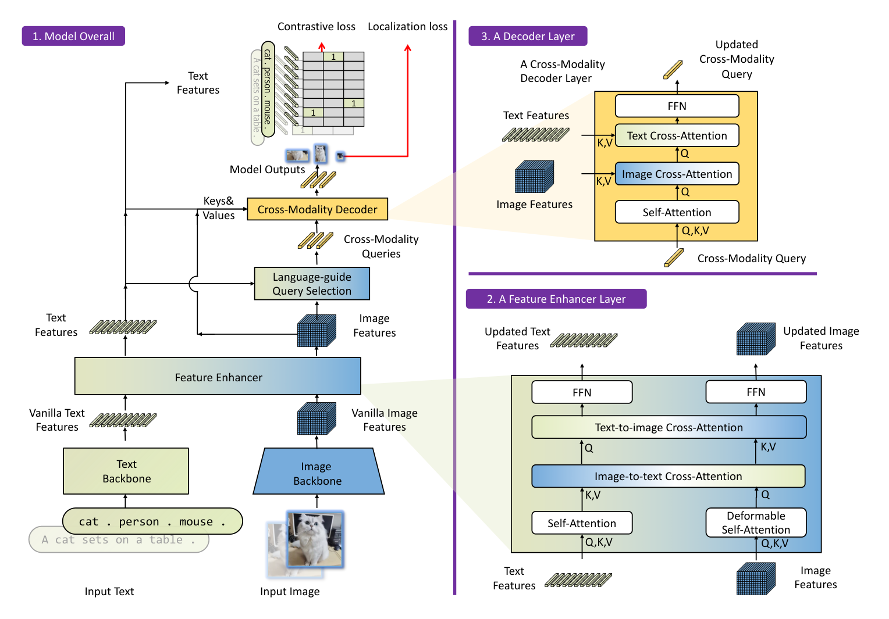
*论文原图编号：Fig 3。整体结构、特征增强层与解码层；语言进入特征增强、查询选择及逐层解码。*

### 查询选择：先选位置，而非直接复制文本特征

视觉与文本特征分别记为：

$$
X_I\in\mathbb{R}^{N_I\times d},\qquad X_T\in\mathbb{R}^{N_T\times d}.
$$

论文设置特征维度为256；视觉词元通常超过一万个，文本长度上限为256。查询位置索引为：

$$
I_{N_q}=\operatorname{TopK}_{N_q}\left(\max_j (X_I X_T^\top)_{ij}\right),\qquad N_q=900.
$$

最大值沿文本维计算，所以一个视觉位置只需与任一词元高度相关就可能入选。该操作不是对每个类别分别分配固定数量的框，也不是软注意力汇聚。候选排序受提示词影响，因此同一图像输入不同文字会得到不同位置初始化。

这里继承 DINO 的混合查询初始化：位置部分由编码器输出的动态锚框初始化，内容部分仍是可学习查询。不能把“抽取视觉特征”简单理解成内容和位置都直接复制这些特征。附录算法1的变量名存在小笔误，复现时应以相似度矩阵、文本维最大值、视觉维前若干索引这条计算链为准。

> [!figure] Algorithm 1 语言引导查询选择
> 建议位置：方法主线的查询选择之后。
> 放置原因：便于逐项检查相似度矩阵的维度和最大值方向。
> 当前状态：保留占位；自动提取的候选图未通过质量检查，公式和文字已重建关键计算。

### 子句表示：保留词元，隔离不相关类别

把整个短语压成一个向量会损失细粒度信息；直接把所有类别拼成一个文本序列，又会让无关类别互相影响。子句方案在独立类别之间设置注意力掩码，同时允许一个多词类别或描述内部保留上下文关系。它限制的是不必要的文本内部交互，并没有取消图文融合。

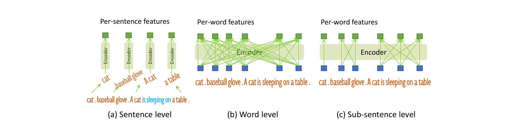
*论文原图编号：Fig 4。句子级、词级和子句级表示的比较；右侧保留局部词语关系，屏蔽独立片段之间的连接。*

### 区域词元分类、匹配和监督

查询与词元点积产生分类分数，再使用焦点损失；定位项采用边界框 L1 与广义交并比损失。先用匈牙利匹配建立预测与真实框的对应，再对匹配结果计算损失。编码器输出和各解码层均有辅助监督。正文给出的最终权重可以概括为：

$$
\mathcal{L}=\mathcal{L}_{\mathrm{cls}}+5\mathcal{L}_{\mathrm{L1}}+2\mathcal{L}_{\mathrm{GIoU}}.
$$

匹配代价中的分类、L1、广义交并比权重为 2、5、2，和最终损失的 1、5、2 不同。附录参数表又出现分类系数 2，说明复现必须锁定检查点对应配置，不能只凭表格或上述概括式决定训练参数。

### 关键实现细节

附录表8列出优化器为 AdamW，主学习率为 $10^{-4}$，图像与文本骨干学习率均为 $10^{-5}$；权重衰减为0.0001，梯度裁剪范数上限为0.1，丢弃率为0。正文与附录的分类匹配系数不一致，实验记录应注明最终采用的配置。

特征增强器和跨模态解码器各六层。T 使用 16 张 V100、全局批大小 32；骨干提取步幅 8、16、32，再从最后一层下采样得到步幅 64。L 使用 64 张 A100、全局批大小 64，骨干从步幅 4 开始提供四级特征。正文将文本分词称作 BPE；工程复现应固定所用 BERT 分词器，避免据这一简称自行替换分词方式。（第9页）

## 关键结果

### 主结果：同配方比较与大模型上限

以下 COCO 数字来自表2，微调列为验证集结果。

| 模型及预训练配方 | COCO 直接迁移 AP | COCO 微调 AP |
|---|---:|---:|
| DINO-T，O365 | 46.2 | 56.9 |
| GLIP-T(B)，O365 | 44.9 | 53.8 |
| Grounding DINO T，O365 | 46.7 | 56.9 |
| GLIP-T(C)，O365+GoldG | 46.7 | 55.1 |
| Grounding DINO T，O365+GoldG | 48.1 | 57.1 |
| Grounding DINO T，再加 Cap4M | 48.4 | 57.2 |
| Grounding DINO L，O365+OI+GoldG | 52.5 | 62.6 |

同 O365 下相对 DINO 只增加 0.5 AP，说明强检测器本体贡献很大；加 GoldG 后 T 从 46.7 到 48.1，支持区域文本训练的额外价值。

L 的 52.5 AP 不能全部归因于融合设计。

加入 COCO 的 L 模型达到 60.7 AP，但表2明确说明这不是真正的 COCO 零样本结果；微调及扩大输入后 test-dev 的 63.0 AP 也不能混入零样本比较。

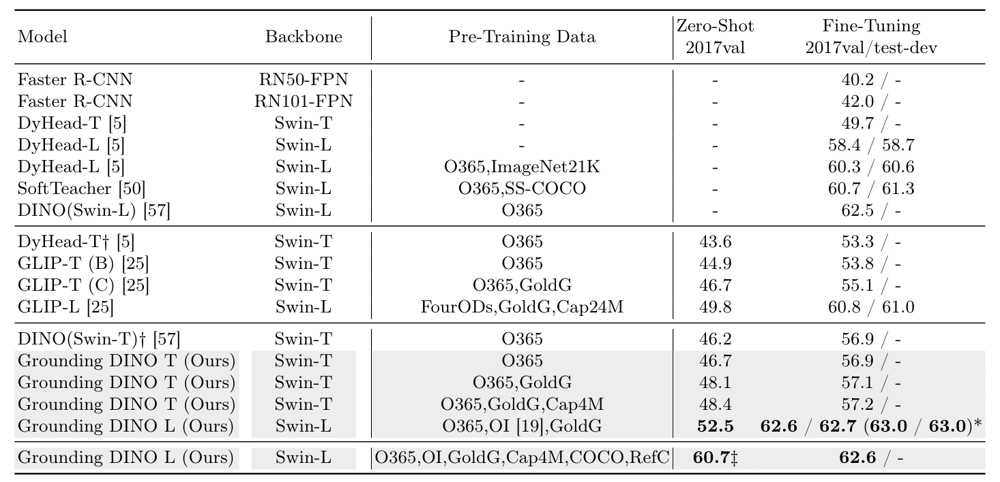
*论文原图编号：Table 2。COCO 完整对比，保留输入尺寸和训练数据差异对应的脚注解释于正文。*

### LVIS：总体收益并未解决长尾

| 模型与配方 | 总 AP | 稀有类 AP | 常见类 AP | 高频类 AP |
|---|---:|---:|---:|---:|
| GLIP-T(C)，O365+GoldG | 24.9 | 17.7 | 19.5 | 31.0 |
| Grounding DINO T，同配方 | 25.6 | 14.4 | 19.6 | 32.2 |
| GLIP-T，加 Cap4M | 26.0 | 20.8 | 21.4 | 31.0 |
| Grounding DINO T，加 Cap4M | 27.4 | 18.1 | 23.3 | 32.7 |
| DetCLIPv2-T，使用 CC15M | 40.4 | 36.0 | 41.7 | 40.0 |

Grounding DINO 的总 AP 更高，但两组配方的稀有类均落后 GLIP。

Cap4M 带来 1.8 AP，而 GLIP 增加 1.1 AP，支持当前范围内的数据扩展收益；只有这一个扩展点，不能推导出通用的规模规律。

DetCLIPv2 的零样本结果明显更好，但数据也不同。

LVIS 微调后 Grounding DINO T 达到 52.1 AP，高于 DetCLIPv2-T 的 50.7；它说明目标域适配有效，不能反推零样本覆盖已经充分。

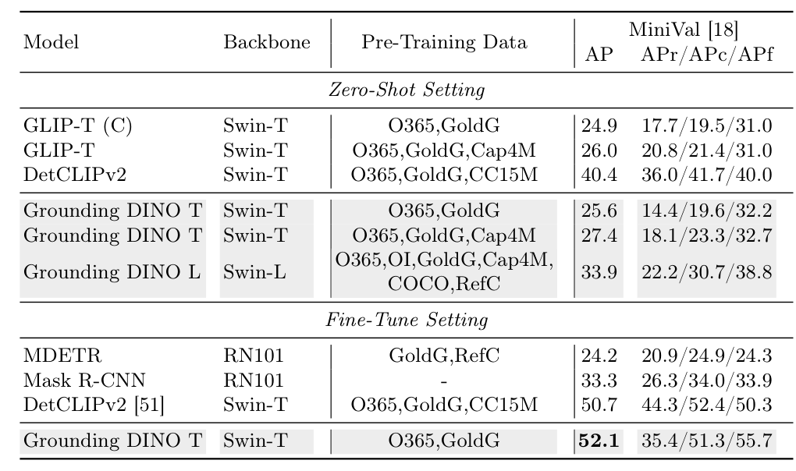
*论文原图编号：Table 3。LVIS 总分与类别频率分组，零样本和微调设置分开呈现。*

### ODinW：同时看平均和中位数

| 零样本模型                       | 平均 AP | 中位 AP |
| --------------------------- | ----: | ----: |
| GLIP-T，O365+GoldG+Cap4M     |  19.6 |   5.1 |
| GLIPv2-T，同数据名配方             |  22.3 |   8.9 |
| Grounding DINO T，O365+GoldG |  20.0 |   9.5 |
| Grounding DINO T，加 Cap4M    |  22.3 |  11.9 |
| Grounding DINO L，完整混合配方     |  26.1 |  18.4 |

T 与 GLIPv2-T 均值相同，中位数更高，说明典型数据集上的表现更好；单凭中位数不能严格证明方差更小。

少样本和全样本训练下 T 分别达到平均 46.4、70.7 AP，属于适配结果。

附录表18显示 PlantDoc 为 0.36 AP，低于 GLIP 的 1.10，说明整体改善不能保证专业疾病类别可用。

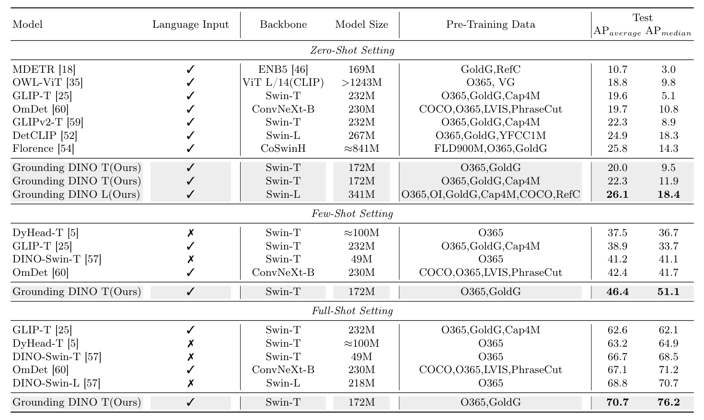
*论文原图编号：Table 4。ODinW 的零样本、少样本和全样本设置，三者不可横向混为直接迁移。*

### REC 与训练数据配方：能力间有代价

没有 RefC 训练时，T 在 RefCOCO 验证集为 50.41，GLIP 为 49.96；RefCOCOg 分别为 67.46、65.58。

表5中同为 O365+GoldG+RefC 的 T，微调标记不同，RefCOCO 验证集可由 73.98 到 89.19。

不能只按预训练数据文字相同就把两行看成同一个实验。大模型的最佳结果还带有两类数据图像重叠的风险脚注。

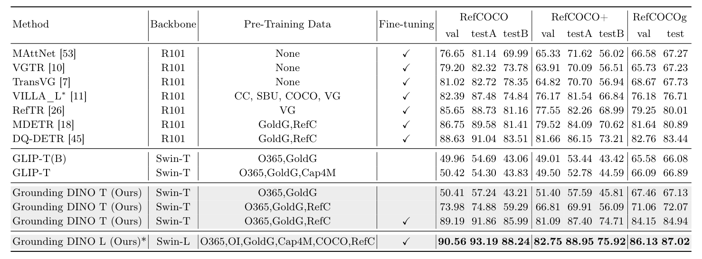
*论文原图编号：Table 5。REC 第一候选准确率；微调标记对理解相同数据配方的两行至关重要。*

表6进一步揭示专门任务数据可能损害跨域能力：

| 训练配方 | COCO直接评估 | LVIS评估 | ODinW评估 |
|---|---:|---:|---:|
| O365+GoldG | 48.1 | 25.6 | 20.0 |
| 加 RefC | 48.5 | 21.9 | 17.7 |
| 再加 COCO | 56.1 | 22.3 | 17.4 |

最后一行 COCO 已参与训练，不再是同一零样本口径。RefC 倾向从一个描述选中唯一实例，通用定位数据则经常对应多个对象，监督目标差异为能力迁移的冲突提供了解释。（第13页及附录D.3）

### 消融到底说明了什么

所有行使用 O365 与 Swin-T，以下以表7实际数值为准：

| 变体 | COCO 零样本 AP | COCO 微调 AP | LVIS 零样本 AP |
|---|---:|---:|---:|
| 完整模型 | 46.7 | 56.9 | 16.1 |
| 移除编码器融合 | 45.8 | 56.1 | 13.1 |
| 静态查询选择 | 46.3 | 56.6 | 13.6 |
| 移除文本交叉注意力 | 46.1 | 56.3 | 14.3 |
| 普通词级提示 | 46.4 | 56.6 | 15.6 |

编码器融合对应 LVIS 3.0 AP 的收益；动态查询对应 2.5 AP，文本交叉注意力对应 1.8，子句提示对应 0.5。正文将查询选择收益写为 3.0，与表格相减不符。逐项移除说明各模块在完整系统中有用，但不能把这些差值相加成独立贡献，也没有全组合实验排除交互作用。

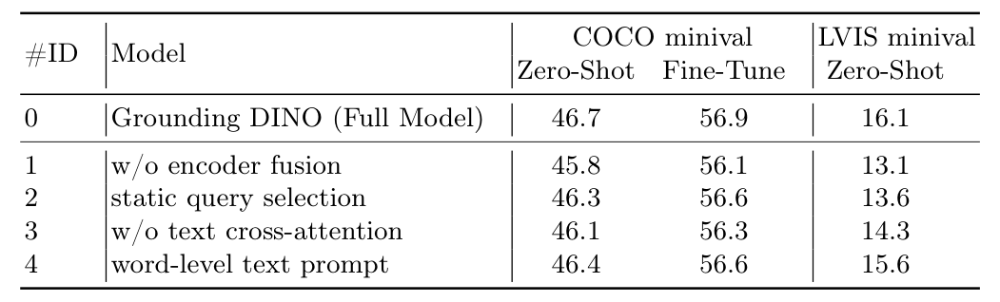
*论文原图编号：Table 7。逐项移除实验，所有变体共享基础训练配方。*

## 深度分析

### 为什么三处融合有效，但类别检测仍不等于关系理解

特征增强先将视觉区域与文字对齐；查询选择再把有限解码预算分配给语言相关的位置；解码器中的文本注意力允许候选框在细化时继续访问语言条件。表7支持这一机制链，但不能仅凭结果证明某个注意力头已经学会关系推理。

查询排序对文本取最大值，适合“任何一个词相关就值得检测”的类别集合场景；它不会显式要求对象同时满足颜色、关系和指代条件。这是对公式结构的推断，不是作者直接测得的因果解释。REC 还要求在多个同类对象中选中唯一实体，而定位预训练可能奖励找出多个名词对象。未训练 REC 时表现偏低，与这一目标错配一致。

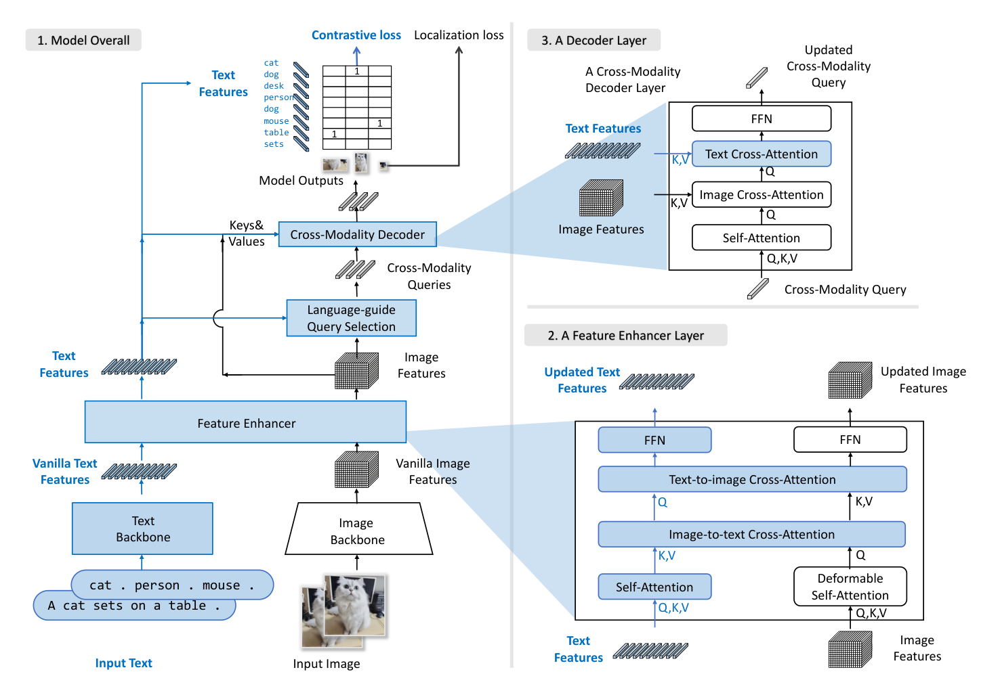
*论文原图编号：Fig 5。与 DINO 的模块差异，蓝色突出新增部分；它说明改造路径，不替代消融证据。*

### 成本、查询数与可复用训练路线

视觉文本相似度矩阵需要随 $N_I N_T d$ 增长的乘加工作，查询自注意力还受查询数量影响；这是根据计算式推导的复杂度，而非论文给出的完整运行时模型。附录将查询从 900 扩到 1200、1500，收益很小，不能靠增加候选数量解决长尾语义覆盖。原表15中三者 COCO AP 为 46.7、46.7、46.9，LVIS 稀有类 AP 为 9.4、9.7、9.2，稀有类并未单调改善。

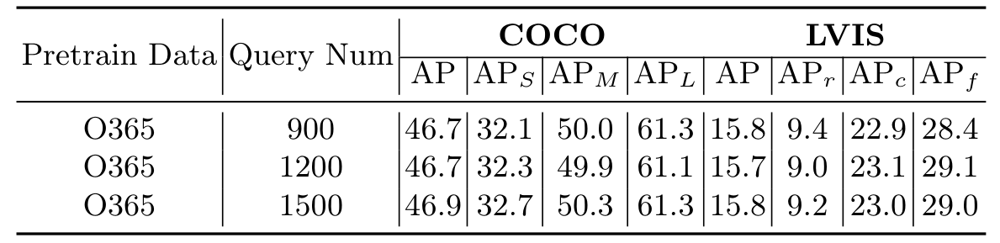
*论文原图编号：Table 15。查询数量扩展实验；整体收益较小，稀有类别指标不单调。*

表20报告 T 为 172M 参数、464G 运算量、8.37 FPS；GLIP-T 为 232M、488G、6.11 FPS。

这支持该评测环境内更紧凑、更快，不能直接当作目标设备的实时性保证。

现有 DINO 权重也可复用：冻结共享模块，仅训练新增文本与融合模块。

表9在 O365+GoldG 下得到 COCO/LVIS/ODinW 为 46.4/26.1/18.5，相对从头训练的 48.1/25.6/20.0 并非全面持平，应按目标任务权衡成本与收益。

### 闭集反例与复现注意点

在 ResNet-50、12轮 COCO 闭集训练中，Grounding DINO 为 48.1 AP，低于 DINO 的 49.0。新增跨模态结构并不自动改善短周期闭集优化；作者提出优化更困难的解释，但并未用单独实验验证这一原因。

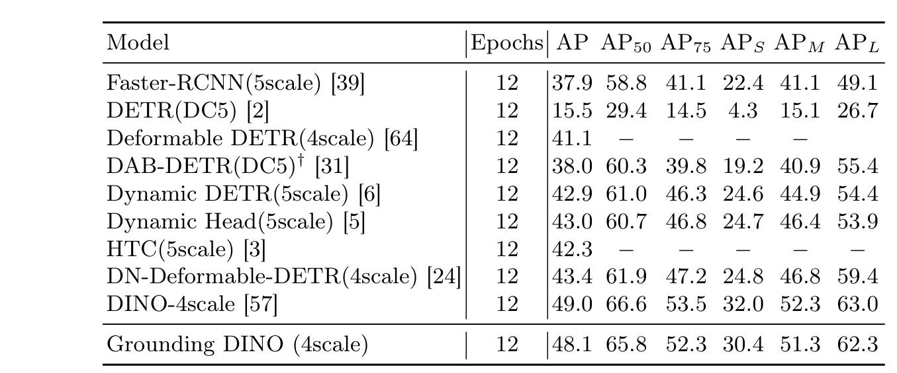
*论文原图编号：Table 11。固定闭集短训练协议下的比较，保留了 Grounding DINO 落后于 DINO 的反例。*

复现时先锁定 PDF 版本、检查点、O365 版本和数据配方，再固定类别列表、句段边界、分词器、图像尺寸、分数阈值及短语合并方式。把类别名替换、类别顺序扰动、添加无关类别分别作为诊断实验，才能区分语义泛化和提示敏感性。这些是本笔记的实验建议，论文没有提供它们的结果。

### 跨域分布的证据补充

下列原表用于查阅具体领域的表现，补充汇总分数无法展示的差异。表12对应 T 的 O365+GoldG，表14对应更强的 L 配方；不能只按模型字母忽略训练差异。表18可以直接查看 GLIP 与 T 的领域间胜负。

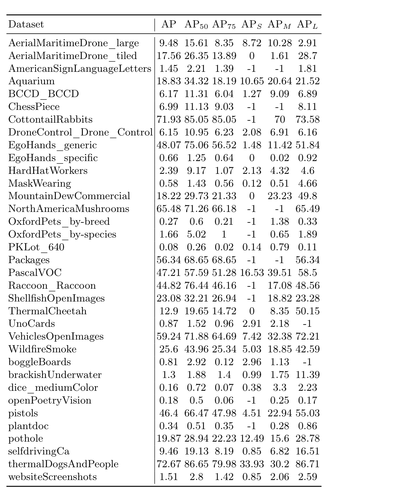
*论文原图编号：Table 12。T 在35个 ODinW 数据集上的详细结果。*

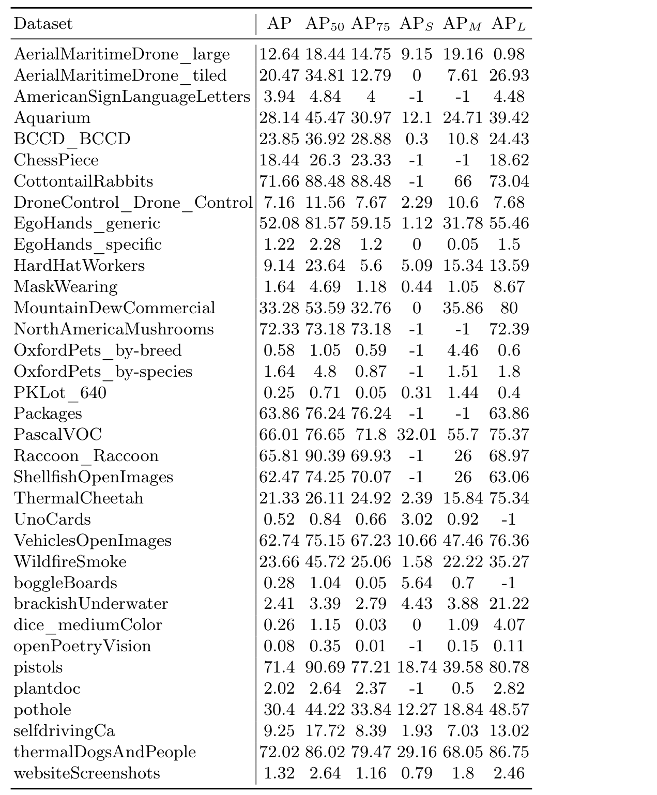
*论文原图编号：Table 14。L 在 ODinW 上的详细结果。*

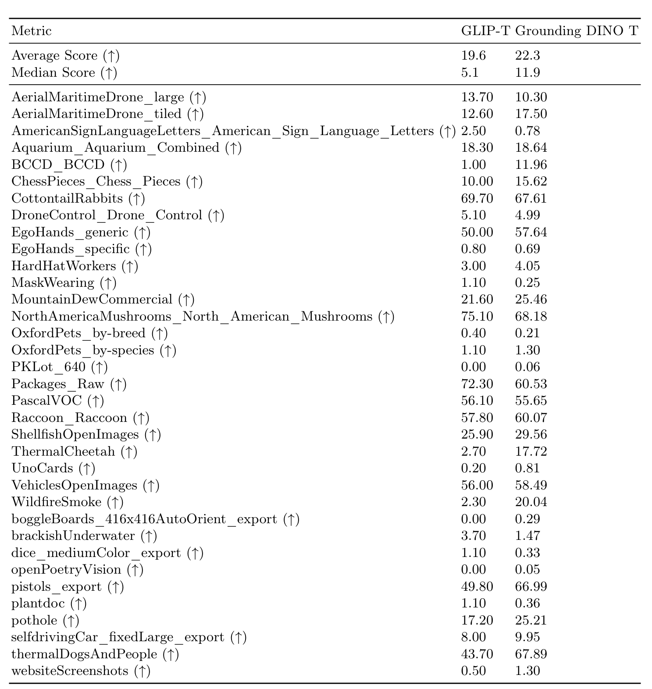
*论文原图编号：Table 18。相同领域上的 GLIP-T 与 Grounding DINO T 对比，展示汇总分数背后的失败项。*

## 局限

1. **开放类别并非无限知识。** 长尾稀有类落后、专业类别接近零的结果表明，语义名称可输入不等于模型具备相应视觉知识。作者将部分差异归因于分布覆盖，但未把数据、架构和训练预算彻底分离。
2. **细粒度语言仍弱。** 没有 REC 训练时表现不高；附录中增大 BERT 也未稳定获益，只能说明当前初始化和18轮训练下没有明显改善，不能证明语言分支已经足够。
3. **评测泄漏与口径。** 表5说明 COCO 可能包含 RefC 验证图像；标签不同不能排除图像重叠的影响。用 LVIS 训练过的 Detic 生成伪标注，也不应称为严格零样本。
4. **误检和拒识不足。** 作者承认存在假阳性；本文没有给出针对不存在目标的可靠拒识保证，图像编辑应用会继承错误框。
5. **输出与统计边界。** 模型本身不输出分割掩码，和生成模型组合的可视化不是分割能力证明。主要表格没有多随机种子区间，小幅 AP 提升仍需重复验证。

## 我的笔记

### 值得复用的结论

最值得保留的是“语言参与候选分配”的设计，而不仅是文本相似度分类头。想将一个强闭集检测器改为开放词汇模型，可以依次检查特征对齐、候选路由、逐层细化三个接口。冻结已有 DINO 的路径为低预算实验提供了起点，但要同时测量跨域损失。

训练数据选择应服务目标任务：若主要做指代定位，可引入 RefC；若强调未知领域迁移，就需要监控 LVIS 和 ODinW 是否退化。不能用 COCO 的明显增长掩盖两个跨域指标下降。

### 后续可检验问题

- 固定训练数据和步数，仅改变类别顺序、同义词及无关类别数量，子句掩码是否降低结果波动？
- 在同一个检查点上，语言引导查询对长尾类别的召回改善有多少发生在解码之前，多少发生在解码之后？
- 固定误检率评测不存在的类别提示，分数校准或显式拒识能否改善编辑场景的安全边界？
- 冻结 DINO 与全量训练在相同算力预算下，哪一种更适合目标领域，而不是只比较相同步数？

### 原图资料与保留占位

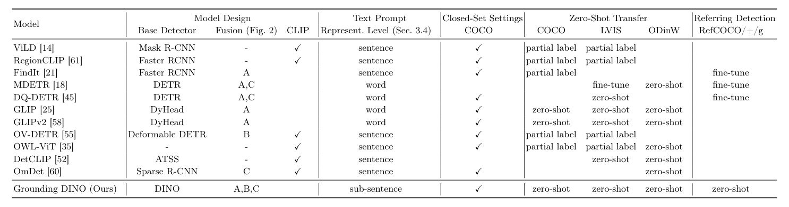
*论文原图编号：Table 1。原论文对相关方法、融合位置和已报告评测设置的归纳。*

> [!figure] Table 8 训练参数
> 建议位置：关键实现细节之后。
> 放置原因：核对训练参数以及正文和附录的系数差异。
> 当前状态：保留占位；候选裁剪缺失上部表体，不插入残缺图像。

> [!figure] Table 13 ODinW 详细结果
> 建议位置：跨域分布的证据补充。
> 放置原因：补充加入图像描述数据后 T 模型的详细表现。
> 当前状态：保留占位；候选图像错误地指向正文，无法确认完整表体。

> [!figure] Table 9 冻结已有 DINO 的迁移结果
> 建议位置：成本、查询数与可复用训练路线。
> 放置原因：比较低成本迁移与从头训练。
> 当前状态：保留占位；自动候选未通过质量检查，关键数值已在正文重述。

> [!figure] Table 10 训练曲线
> 建议位置：成本、查询数与可复用训练路线。
> 放置原因：展示预训练初始化的早期收敛效果。
> 当前状态：保留占位；自动候选未通过质量检查，且原文将曲线称作表10，需按页面辨认。

> [!figure] Table 20 效率对比
> 建议位置：成本、查询数与可复用训练路线。
> 放置原因：同时核对参数量、运算量与速度。
> 当前状态：保留占位；自动候选未通过质量检查，已在正文保留报告数值。

> [!figure] Table 16 语言编码器大小比较
> 建议位置：我的笔记，作为语言编码器实验的补充。
> 放置原因：限定增大语言编码器未稳定改善的实验范围。
> 当前状态：保留占位；未取得可靠图像候选。

> [!figure] Table 17 伪标注分布实验
> 建议位置：我的笔记，作为伪标注实验的补充。
> 放置原因：明确使用已见 LVIS 的教师不属于严格零样本。
> 当前状态：保留占位；未取得可靠图像候选。

> [!figure] Table 19 REC 从头训练
> 建议位置：细粒度语言能力的讨论。
> 放置原因：区分任务专门训练和零样本迁移。
> 当前状态：保留占位；未取得可靠图像候选。

## 引用

- 本笔记依据本地 PDF 的 arXiv:2303.05499v5，全篇33页；方法见第5—9页，主结果见表2—7，训练和额外实验见附录B—D。
- [Grounding DINO 原文及版本](https://arxiv.org/abs/2303.05499v5)
- [Grounding DINO 作者代码仓库](https://github.com/IDEA-Research/GroundingDINO)
- [GLIP：定位预训练路线](https://arxiv.org/abs/2112.03857)
- [DINO：基础检测器](https://arxiv.org/abs/2203.03605)
